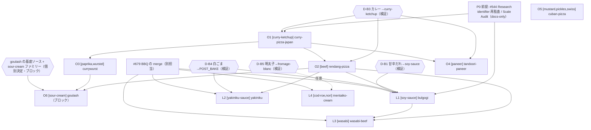

# 10 レシピ単位のバッチ拡張計画（B10）— 第 2 版: 依存関係・先行可否・契約への影響（docs-only）

Status: **計画と調査のみ。runtime は実装していない**（`src/**`・`e2e/**`・CSS・テスト・データ・golden・workflow・本番スイッチ・共有 Preview・Production・Firebase は無変更）。実装・PR 作成・merge・Monitor 作成・Issue/PR へのコメント・claim 投稿はしていない。**#679（BBQ）の担当セッションと、そのブランチ `claude/bbq-chicken-late-catalog` には触れていない**（`origin` の HEAD を読んだだけ）。
基準 `main` = `08cd46d`（食材 75、レシピ 69 + late）。**本計画は #679 の merge 後に着手する前提**。#679 の最新 HEAD は `933e518`（recipes 件数の期待を Pinsa ゲートに追随する修正）。
第 1 版からの更新: Owner 判断（第 2 弾）の反映、ladder 構成の組み替え（beef を通常側 1 材料 step で導入）、解禁バランスの再評価、依存関係図、先行可否の分類、Pinsa / Contract 2.1 / INV-D7 / Research privacy への影響評価。
姉妹資料: `TETO_WASABI-BEEF_FINAL-DESIGN-GATE_2026-10-27.md`（第 2 版の更新あり）、`TETO_BURRATA_FINISH-CHEESE_DESIGN-ISSUE_2026-10-27.md`（変更なし）。
**「提案」は Owner の決定ではない。各レシピの原典（pizzadb.jp）は未確認で、本セッションは到達していない。matrix の記述を原典の事実として断定しない。すべて GAMEPLAY ASSUMPTION として扱う。「推定」は測定値ではない。**
**方法の限界:** 本セッションはリポジトリの依存関係（`node_modules`）を入れておらず、テスト・gate・`check.ts` 型の機械検査は**実行していない**。分析はコードの静読、matrix JSON と `recipes.ts` / `lateCatalog.ts` を読む Python の集合計算、GitHub の PR 統計による。実装前 Gate で機械検査を行う。

## 0. Owner 判断（2026-10-27 第 2 弾）の反映

| 判断 | 反映 |
|---|---|
| わさびビーフピザの表示名を採用 | 表示名 =「わさびビーフピザ」（Gate の D-W1 は解決） |
| beef と soy-sauce の再利用を優先 | §4・§5 の ladder は beef・soy-sauce を通常側 / 他レシピと共有する形に組み替え |
| SVG 候補 A は暫定採用 | beef-A・wasabi-A を暫定。最終は実機 HV（D-W4 は暫定で解決） |
| soy-sauce の色は実機 HV で確定 | 暫定 `#3a2418` のまま HV で確定（D-W6 は解決） |
| **初回 360 Pitz は未承認。解禁バランスを再評価** | §5 で再評価。**360 Pitz になるのは cuban-pizza の step だけ**に収まる構成にした |
| 通常 6 件 + late 4 件を暫定構成 | §5 で構成を確定（通常 6 = 5 件 + 条件付き 1 件、late 4）。差し替え候補を明示 |
| **「その他」ソースの一律 NO_SAUCE 変換は禁止** | goulash・suya は**個別の基底ソース決定が済むまでブロック**として扱う。NO_SAUCE を既定にしない（§3） |
| 甘辛だれ→soy-sauce、カレー→curry-ketchup、白ごま→POST_BAKE、明太子→fromage-blanc-sauce は GAMEPLAY ASSUMPTION として検証可能な候補 | **採用ではなく検証可能な候補**。§9 に検証計画。検証が通るまで実装しない |
| ブッラータ・ホットハニーは HOLD 維持 | 構成に含めない（変更なし） |

## 1. 結論（サマリ）

- **通常 6 + late 4 は、そのままでは実現できない。** 実現可能なのは **9 件（通常 5 + late 4）**で、残る 1 件（通常側の goulash）は**個別の基底ソース決定とファミリー決定**が済むまで出せない。suya は同じ理由で予備に回す。
- 9 件のうち、Owner の新規決定なしで実装準備に進めるのは **currywurst・cuban-pizza・mentaiko-cream-pizza の 3 件**（mentaiko は新しい白ソース `fresh-cream-sauce` を新規にする場合）。残る 6 件は、Owner が検証可能な候補とした仮定（カレー→curry-ketchup、甘辛だれ→soy-sauce、白ごま→POST_BAKE、明太子→fromage-blanc-sauce）の**検証が通ること**が条件。
- **最初に実装すべき群: 通常側の「カレー・牛」チェーン** `currywurst → curry-pizza-japan → rendang-pizza`（+ 独立の `cuban-pizza`、`tandoori-paneer-pizza`）。理由: ① 1 材料 step で `curry-ketchup` と `beef` を通常側に出せる（beef を通常 ladder に置くことが、late の 3 レシピ（bulgogi・yakiniku・wasabi-beef）の前提）、② late catalog を使わないので #679 の merge と独立に進められる部分がある、③ 解禁コストが 120〜240 Pitz に収まる。**late 4 件は #679 の merge と beef の導入（rendang）の後。**
- 契約への影響: **Pinsa ON/OFF・INV-D7・Research の privacy に致命的な衝突は見つからなかった**（静読の範囲）。ただし、**Contract 2.1 §13.1 の「53 / 172 population 導入前の Research identifier compatibility の Fresh Gate 再監査」（#544）が未実施のまま、カタログは既に 70 近くに達している**。B10（約 80）の実装 PR の前に、docs-only の再監査を前提条件 P0 として置くことを提案する（§8.2）。新規ファミリー（`other`）の混入にも注意（§8.5）。

## 2. 構造制約（第 1 版の C1〜C6 を維持）

`src/data/lateCatalog.ts` の `validateLateCatalog` ほかの静読による（実行はしていない）。

| # | 制約 | 帰結 |
|---|---|---|
| C1 | late recipe は `POST_BAKE` の要件を必ず 1 つ持つ | 焼成後に足すものが無い行は late に入れられない |
| C2 | credited の late recipe は late ladder step の key をちょうど 1 つ務める | 1 つの late recipe は 1 つの late step を要する |
| C3 | `ladderCredit: false` の late recipe は late 専用の材料を使えない | 新材料を持たない late recipe は白ごま等を使えない |
| C4 | late 専用の材料は通常カタログに存在しない（OFF で消える）。通常レシピは late 専用の材料を使えない（通常側の検査は未確認、設計上の推論） | **材料をどちらの ladder に置くかが、使える行の集合を決める** |
| C5 | 通常 ladder は追記専用。通常 step が増えると late step の導出番号が +1 ずれる（`LATE_ENTITLEMENT_FLOORS` が既存セーブを守る） | 出荷時の導出値で floor を足す（既存規則） |
| C6 | 既に late 専用: `salmon-roe`・`yuzu-kosho`・`miso-sauce`・`white-sesame`・`tahini`・`pomegranate`（main）、`bbq-sauce`・`cilantro`（#679） | これらを使う行は late recipe にしかできない（baingan-bharta・chicken-tikka は cilantro のため対象外） |
| **C7（新）** | 通常 step は複数材料を持てる（既存: `[cream-cheese, lemon, salmon]`、`[fontina, gorgonzola, parmigiano]` など 3 材料の前例あり） | 3 材料の通常 step は前例がある。**ただし 3 材料 = 360 Pitz は重い（§5）** |

## 3. goulash・suya・rendang の比較（基底ソースと工程）

matrix（`docs/design/data/TETO_RECIPE_172_GAME-DESIGN-CANDIDATE_MATRIX.json`）の記録。3 行とも**証跡は比較表の標本のみ**（個別ページなし）、生地は「薄め」（未モデル化）、`prep` なし、後乗せなし、必要機構なし。

| 項目 | goulash-pizza | nigerian-suya-pizza | rendang-pizza |
|---|---|---|---|
| 国・地域（matrix） | ハンガリー | ナイジェリア | インドネシア / 西スマトラ |
| 材料 | beef・onion・paprika-powder・sour-cream | beef・green-pepper・mozzarella・onion | beef・mozzarella・onion |
| 基底ソース欄 | `その他`（**未特定**） | `その他`（**未特定**） | `カレー`（**未特定**。「カレーソースが列挙されていれば満たす」規則） |
| 基底ソースの根拠 | 無い。matrix は「どの spread 系の材料も満たす、無ければ未特定」とする | 無い（同上） | Owner が検証可能な候補とした `curry-ketchup`（currywurst の列挙された基底。**カレー全般の下地に使ってよいかは仮定**） |
| 新材料 | beef・sour-cream（paprika-powder は currywurst と共有） | beef | beef（curry-ketchup は共有） |
| 工程（matrix） | 下ごしらえ・後乗せなし。通常フロー | 同左 | 同左。**ルンダンは長時間煮込む料理だが、matrix に工程の記録は無く、下ごしらえは未モデル化（GAMEPLAY ASSUMPTION）** |
| 材料集合の近接（既存 69 レシピとの比較、Python） | 既存と一致・近接なし | 既存と一致・近接なし。**バッチ内で rendang と 2 差**（curry-ketchup・green-pepper） | 既存と一致・近接なし。バッチ内で curry-pizza-japan と 2 差（beef・chicken）、suya と 2 差 |
| 新ファミリーの懸念 | **sour-cream**（乳製品。`other` に分類されると DH4 の「その他は到達不能」に触れうる。§8.5） | なし（beef = meat、green-pepper は既存） | なし |
| 判定 | **ブロック**: 基底ソースの個別決定 + sour-cream のファミリー決定 | **ブロック**: 基底ソースの個別決定（根拠なし）。**予備に回す** | **条件付き先行**: 検証可能な候補（カレー→curry-ketchup）の検証が通れば出せる |

### 3.1 goulash・suya の基底ソース: 選択肢（**決定ではない。NO_SAUCE を既定にしない**）

| 選択肢 | goulash | suya | 影響 |
|---|---|---|---|
| (a) 既存ソースを個別に選ぶ（例: `tomato-sauce`、`fromage-blanc-sauce`） | 煮込み（赤）か白いクリームか。原典根拠なし。GAMEPLAY ASSUMPTION | 根拠なし | 既存ソースの再利用で新材料は増えない。ただし**原典から離れた仮定**であり、Hint の BASE 段・Research の ○× に既存ソースが並ぶ |
| (b) 新規のソース材料 | 例: パプリカ系の煮込みだれ | 例: スパイス系のだれ（`yaji` 風） | 新材料 +1（120 Pitz の step が 1 つ増える）。再利用先が無い |
| (c) **個別に** NO_SAUCE（Owner が当該レシピについて明示承認する場合のみ） | 禁止されているのは「一律変換」。個別の承認は可能だが、根拠が matrix に無い | 同左 | NO_SAUCE の population が増える（§8.3: INV-D7・DH4・技法 `no-sauce` の再検証が要る） |
| (d) 保留（ブロックのまま） | **推奨（現時点）** | **推奨（現時点）** | 構成から外す。差し替え候補は §5.2 |

**助言:** goulash・suya は matrix に基底ソースの手がかりが無く、どの選択肢も根拠のない仮定になる。**カレー系（rendang）は Owner が検証可能な候補を示した**ので先に進め、goulash・suya は決定が揃うまで保留するのが妥当。

## 4. beef を通常側で導入するための最小構成

beef を late 専用にすると他の beef 行が使えなくなる（C4）ため、**通常 ladder の step で出す**。通常 step の key は「その step の材料以外がすべて base の材料である通常レシピ」でなければならない。

| 案 | step | key レシピ | 必要な決定 | コスト | 評価 |
|---|---|---|---|---|---|
| **M1（推奨）** | `[beef]`（1 材料、120 Pitz） | **rendang-pizza**（beef・mozzarella・onion + curry-ketchup） | カレー→curry-ketchup の検証（D-B3）。curry-ketchup は先行 step（curry-pizza-japan の `[curry-ketchup]`）で出す | **最小**（1 材料） | beef の導入が 1 材料 step で済み、他に新材料が要らない。検証が通らなければ M2 / M3 は決定待ちのため**導入役がいなくなる**（下記フォールバック） |
| M2 | `[beef, sour-cream]`（240） | goulash-pizza | goulash の基底ソース・sour-cream のファミリー | 中 | 2 つの個別決定に依存 |
| M3 | `[beef]`（120） | nigerian-suya-pizza | suya の基底ソース（根拠なし） | 最小 | 決定の根拠が無い。非推奨 |
| M0 | late 専用（`wasabi-beef` の late step に beef を入れる） | — | なし | — | **beef の再利用を失う**（C4）。単独の退避案 |

**M1 のフォールバック:** カレー→curry-ketchup の検証が通らない場合、curry-ketchup は currywurst の step に自前の基底として入る（`[curry-ketchup, paprika-powder, wurstel]`、360 Pitz）。curry-pizza-japan・rendang・tandoori-paneer は出せず、**beef の導入役がいなくなる**ため、late の beef 系 3 件（bulgogi・yakiniku・wasabi-beef）は M0（beef を late 専用）に退避するか、保留になる。→ **D-B3 の検証がバッチ全体の要**。

## 5. 改訂した構成と解禁バランス

### 5.1 ladder（提案）と解禁コスト

材料の購入: T4（step 30 以降）は **1 材料の first pack = 120 Pitz、refill = 60 Pitz、1 pack = 10 プレイ分**（`materialShop.ts`）。1 ラウンドの収入は `100 × 品質倍率`（★に対応: 0.5〜1.2、最低 20 Pitz）+ **そのレシピの初発見ボーナス 50 Pitz**（`pitzReward.ts`）。以下の「ラウンド換算」は 1 ラウンド = 80 / 100 / 120 Pitz（倍率 0.8 / 1.0 / 1.2）での目安（**推定**）。

| 順 | 種別 | step（材料 → key レシピ） | 材料数 | first pack 合計 | ラウンド換算 | 決定への依存 |
|---|---|---|---|---|---|---|
| O1 | 通常 | `[curry-ketchup]` → curry-pizza-japan | 1 | 120 | 1.0〜1.5 | D-B3 |
| O2 | 通常 | `[beef]` → rendang-pizza | 1 | 120 | 1.0〜1.5 | D-B3（O1 が前提） |
| O3 | 通常 | `[paprika-powder, wurstel]` → currywurst | 2 | 240 | 2.0〜3.0 | なし（O1 の curry-ketchup を使う。フォールバック §4） |
| O4 | 通常 | `[paneer]` → tandoori-paneer-pizza | 1 | 120 | 1.0〜1.5 | D-B3 |
| O5 | 通常 | `[mustard, pickles, swiss-cheese]` → cuban-pizza | 3 | **360** | **3.0〜4.5** | ファミリー決定（pickles・mustard） |
| O6 | 通常（条件付き） | `[sour-cream]` → goulash-pizza | 1 | 120 | 1.0〜1.5 | **goulash の基底ソース + sour-cream のファミリー（ブロック）** |
| — | 通常（非 credited） | key なし: nigerian-suya（予備） | 0 | — | — | suya の基底ソース（ブロック） |
| L1 | late | `[soy-sauce]` → bulgogi-pizza | 1 | 120 | 1.0〜1.5 | D-B1、D-B4、O2 が前提 |
| L2 | late | `[yakiniku-sauce]` → yakiniku-pizza | 1 | 120 | 1.0〜1.5 | D-B4、O2 が前提、炒め工程の未モデル化 |
| L3 | late | `[wasabi]` → wasabi-beef-pizza | 1 | 120 | 1.0〜1.5 | O2・L1 が前提 |
| L4 | late | `[cod-roe, nori]` → mentaiko-cream-pizza | 2 | 240 | 2.0〜3.0 | D-B5（`fresh-cream-sauce` を新規にすると 3 材料 = 360）、nori のファミリー |

**再評価の結果（初回 360 Pitz）:** 第 1 版の構成では wasabi-beef の 3 材料 step（beef・soy-sauce・wasabi = 360）と cuban・currywurst の 3 材料 step があった。**組み替え後は、360 Pitz になる step は cuban-pizza の 1 つだけ**で、wasabi-beef は beef（O2、120）・soy-sauce（L1、120）・wasabi（L3、120）に**分散**した。**わさびビーフを作るまでの合計は同じ 360 Pitz だが、1 つの step あたりは 120 Pitz**で、既存の通常 ladder の大半（1 材料）と同じ負担になる。
- cuban の 360 Pitz は残る。選択肢: (i) 許容（3 材料の通常 step は前例あり、C7）、(ii) 最後に回す（解禁順を後ろにする。コストは変わらない）、(iii) 差し替える（§5.2）。**Owner 判断（D-E1）。**
- 直列の依存（O1 → O2 → L1 → L3）により、わさびビーフは**解禁が 4 step 先**になる。1 つの recipe を作るまでに購入する材料は beef・soy-sauce・wasabi の 3 つで、その間に別レシピの発見が進む。段階的な解禁にはなるが、**わさびビーフ単独の「手が届くまでの距離」は第 1 版より長い**。
- 1 プレイあたりの材料コスト（refill 60 Pitz / 10 プレイ = 6 Pitz / 材料 / プレイ）は、わさびビーフで約 18 Pitz（beef・soy-sauce・wasabi）。収入（80〜120 Pitz + 初回 50）に対して軽い（推定）。
- credited は ordinary 5（curry-japan・rendang・currywurst・tandoori・cuban）+ 条件付き 1（goulash）+ late 4。各 credited レシピが自前の step を持つので、`ACCEPTED_MIN_SLACK`（= 1）の余裕は保たれる見込み（**実装前に `ladderReachability.starGate` で確認**）。

### 5.2 構成（暫定 6 + 4 の確定案）と差し替え候補

| 区分 | レシピ | 状態 |
|---|---|---|
| 通常 | currywurst | 先行可（決定なし） |
| 通常 | cuban-pizza | 先行可（ファミリー決定のみ） |
| 通常 | curry-pizza-japan | 条件付き（D-B3 の検証） |
| 通常 | rendang-pizza | 条件付き（D-B3、**beef の導入役**） |
| 通常 | tandoori-paneer-pizza（**第 1 版の suya の代わりに追加**。材料 green-pepper・mozzarella・onion + 新材料 paneer、基底 `カレー`、証跡は比較表の標本のみ） | 条件付き（D-B3） |
| 通常 | goulash-pizza | **ブロック**（個別の基底ソース + sour-cream のファミリー）。決まらなければ枠を空ける |
| late | bulgogi-pizza | 条件付き（D-B1、D-B4、rendang 後） |
| late | yakiniku-pizza | 条件付き（D-B4、炒め工程の未モデル化、rendang 後） |
| late | wasabi-beef-pizza | 条件付き（rendang 後、soy-sauce は bulgogi の step か自前） |
| late | mentaiko-cream-pizza | 先行可（`fresh-cream-sauce` 新規）／D-B5 の検証が通れば新材料 −1 |
| 予備（構成外） | nigerian-suya-pizza | ブロック（基底ソースの根拠なし） |
| 除外（HOLD・制約） | ブッラータ系・ホットハニー、baingan-bharta・chicken-tikka（cilantro が late 専用）、philly-cheesesteak（suya と材料集合が衝突）、meat-lovers（出荷済みと構成が食い違う） | — |

新材料の延べ数（個別）は 23 → **本改訂後のバッチ全体は 15 種**（curry-ketchup、beef、paprika-powder、wurstel、paneer、mustard、pickles、swiss-cheese、sour-cream、soy-sauce、yakiniku-sauce、wasabi、cod-roe、nori、fresh-cream-sauce。D-B5 で 14）。goulash を外すと sour-cream が不要になり 14 種（13）。

## 6. 依存関係の図

- 実線は「前提」、`{{ }}` は Owner の検証・決定、点線は任意。**ordinary 側（O1〜O6）は #679 に依存しない**（late catalog を使わない）が、通常 step を足すと late step の導出番号がずれる（C5）ので、late 側は #679 の merge 後に着手する。
- **クリティカルパス: D-B3 → O1 → O2 → L1 → L3（わさびビーフ）。**
- 独立: O5（cuban）、L4（mentaiko、新規白ソースなら）。

## 7. 先行可能とブロックの分類

| 分類 | レシピ | 条件・理由 |
|---|---|---|
| **先行可能**（Owner の新規決定なしで実装準備） | currywurst、cuban-pizza、mentaiko-cream-pizza | currywurst は基底が列挙済み、cuban・mentaiko（新規白ソース）は他に依存しない。cuban はファミリー（pickles・mustard）の確認が要る |
| **条件付き先行**（検証可能な候補の検証が通れば） | curry-pizza-japan・rendang・tandoori-paneer（D-B3）、bulgogi（D-B1・D-B4）、yakiniku（D-B4）、wasabi-beef（rendang・bulgogi 後）、mentaiko（D-B5 を使う場合） | §9 の検証計画で通った後 |
| **外部ブロック** | late 4 件すべて | #679 の merge（hot file・late step の導出）、beef の導入（rendang） |
| **ブロック**（個別決定が必要） | goulash、nigerian-suya | 基底ソースの根拠なし。NO_SAUCE を既定にしない（Owner 判断） |
| **前提条件** | 全レシピ | P0（#544 の再監査）。§8.2 |
| **HOLD（Owner 維持）** | ブッラータ系、ホットハニー | — |

## 8. 契約・機構への影響評価（静読。実測は未実施）

### 8.1 Pinsa ON / OFF
- **直接の依存なし。** B10 は `pinsa-romana` の材料（`prosciutto-crudo`・`arugula`）も Pinsa の生地種別も使わない（標準生地）。
- **late step 番号:** Pinsa は `ladderCredit: false` で late step を持たない。したがって Pinsa の ON/OFF は late step の導出番号を動かさない（C5 は通常 step の追加だけが動かす）。
- **件数 pin:** レシピ総数は ON/OFF で 1 差がある。B10 の件数 pin は `catalogDerived` 系の導出で書き、**`npm run test:pinsa-off`（`TETO_PINSA_OFF=1`）で両状態を通す**こと。#679 の最新コミット `933e518`（件数の期待を Pinsa ゲートに追随）が前例。
- **★ / credited の境界:** state-sync は「Pinsa ゲートを閉じると credited 数と ★ の境界が動く」と記録している（STATE-SYNC §2 リスク 4）。B10 は credited +9〜10 / step +9〜10 なので slack は保たれる見込みだが、**ON/OFF 両方で `ladderReachability.starGate` を実測する**。
- **Research コホート:** Pinsa は arugula のコホートに入り、jamon が `-->B` になる（Q7 で承認済み）。B10 のレシピは arugula 系に入らず、新材料の last-acquired が各自の step の最後の材料になるため、**既存レシピの文字を動かさない見込み**。実装時は `acceptedLetterShifts` を**空のまま**にし、観測された変化は失敗として扱う。
- ロールバック（`PINSA_PRODUCTION = false`）後も B10 が成立すること（B10 が Pinsa に依存しないこと）をテストで確認する。

### 8.2 Contract 2.1（Anti-Oracle）
- **§13.1 Scale Audit の再監査 trigger:** 「53 / 172 population を導入する前の Research identifier compatibility の Fresh Gate 再監査」（Issue #544）は、**カタログが 53 件・57 件に達した時点でも実施されていない**と記録されている。現在のカタログは約 70 件で、B10 で約 80 件になる。**B10 の実装 PR の前に、docs-only の再監査（cohort letter の安定性、INV-B7、§15 の複数ソース前提での再計算）を前提条件 P0 とすることを提案する。** §15 の再計算が既に実施されたかは本セッションでは確認できていない（要確認）。
- INV-D1（topping の開示は未知 ≤ 3）・INV-D3（verdict parity）・INV-D4（panel presence は player の入力だけ）・INV-D6: 新材料の追加で変わらない（ソース行は「使った sauce の全件」を判定する構造で、sauce の数に上限を置かない）。
- Hint 5.0 の key-free BASE 段（全ソース + 全チーズ、10 Pitz）: 新しいソース（curry-ketchup、soy-sauce、yakiniku-sauce）とチーズ（swiss-cheese、paneer）が加わるため候補数が増える。**価格・段の構造は不変**。
- late 側: `LATE_ADDITION_RECIPE_IDS`（`techniqueAllowlists.ts`）に 4 件の明示 id を追記し、privacy assertion は緩和しない（U1〜U3・BBQ と同じ）。

### 8.3 INV-D7（「なし」の非開示）と NO_SAUCE
- **B10（確定構成）には NO_SAUCE のレシピを入れない**（goulash・suya を保留にしたため）。INV-D7（パネル・aria・Notebook・保存に「ソースなし」相当を置かない）、OD-TQ1D-4、INV-D4 の再検証は不要。
- **将来 goulash・suya を個別に NO_SAUCE にする場合は**、NO_SAUCE の population（`aussie` ほか）に加わるため、`researchResultRows.test.ts`・`gameReducer.techniques.privacy.test.ts`・`hint5Production.gate.test.ts`・`deductionProduction.gate.test.ts` の privacy sweep の再実行と、`noSauceRecipeIds()` の導出・技法 `no-sauce` の発見経路の再確認が要る。Owner が一律変換を禁止した理由（根拠のない一括処理の回避）とも整合する。

### 8.4 Research の privacy（INV-B7 ほか）
- Research Entry のラベルは「解禁の食材名とコホート文字」だけを持つ（INV-B7）。late recipe のラベルも通常と同じ形で、**投入時機を示さない**（BBQ と同じ）。
- 新しい cohort の鍵は各 step の最後の材料: rendang = beef、currywurst = wurstel（`[paprika-powder, wurstel]` の最後）、curry-pizza-japan = curry-ketchup、bulgogi = soy-sauce、wasabi-beef = wasabi、yakiniku = yakiniku-sauce、mentaiko = nori または cod-roe（順序は実装時に確定）。**1 件 1 コホートで、既存の文字は動かさない見込み**。
- 近接した材料集合（§3 の表）は、Research の候補プール内で「1 材料の差」のレシピが並ぶ。bulgogi と yakiniku は**ソース以外が完全に同じ**（`soy-sauce` と `yakiniku-sauce` の違いのみ）。Research の ○× はソース行を持つため判別できるが、**Anti-Oracle の観点（ソースだけが違うレシピ対）の追加検査**を実装前 Gate に入れる。

### 8.5 DH4 の「その他は到達不能」（OD-DH4-2-9）と新ファミリー
月見が保留されている理由は、egg が `other` ファミリーで DH4 gate に抵触したため。B10 の新材料のうち、`other` に分類されうるものを実装前に決める（**ファミリーは Owner の L1 決定**）。

| 材料 | 候補ファミリー / カテゴリ | `other` のリスク |
|---|---|---|
| sour-cream | 乳製品（topping か sauce か未決） | **高**（goulash のブロック要因の 1 つ） |
| nori | seafood か vegetable か（海藻） | **中** |
| pickles | vegetable（avocado・artichoke の前例では「実野菜」「漬け・缶詰」のタグ決定がある） | 低〜中 |
| mustard | sauce（基底）か spice | 低（sauce なら family 行なし） |
| wurstel | meat（hot-dog = meat の前例） | 低 |
| paprika-powder | spice | 低 |
| cod-roe | seafood（salmon-roe の前例） | 低 |
| beef | meat | 低 |
| wasabi | spice | 低 |
| paneer / swiss-cheese | cheese（family 行なし） | なし |

## 9. 「検証可能な候補」の検証計画（実装前 Gate、本セッションは未実行）

| 候補 | 検証内容 | 失敗時 |
|---|---|---|
| カレー→curry-ketchup（D-B3） | (1) currywurst・curry-pizza-japan・rendang・tandoori の材料集合が既存 69 件と一致・近接しない（**Python で一致・近接なしを確認済み**）、(2) Hint 5.0 の BASE 段・DH4・Research のコホート、(3) curry-ketchup が「カレー全般」の下地として自然かの Owner の見た目確認（HV） | M0 に退避（beef を late 専用）または保留 |
| 甘辛だれ→soy-sauce（D-B1） | bulgogi の基底が soy-sauce でも wasabi-beef・yakiniku と識別できる（材料集合は差 2 以内の近接あり）、`miso-sauce`（dengaku の甘辛だれ）との役割の重なり | bulgogi を保留。wasabi-beef は自前の late step `[soy-sauce, wasabi]`（240） |
| 白ごま→POST_BAKE（D-B4） | bulgogi・yakiniku が late recipe の検査（POST_BAKE あり、step の key、late 専用材料の使用可否）を通る。U2 のナス田楽と同じ暫定の延長であること | bulgogi・yakiniku を外す（late 2 件に減る） |
| 明太子→fromage-blanc-sauce（D-B5） | mentaiko-cream の材料集合が flammkuchen（`fromage-blanc-sauce` を使う）と衝突・近接しない（Python 上、既存 69 件と一致・近接なし）、白ソースの色が cod-roe の視認性を損なわない | `fresh-cream-sauce` を新規（+1 材料、360 Pitz に） |

## 10. 工数・PR 分割（第 1 版の測定値を維持、構成変更を反映）

直近の late catalog 単独 PR の測定値（第 1 版 §4.1: #662 / #669 / #673 は各約 50 files・約 +1000 行、open → merge 1.4〜10 時間）は変わらない。**差は行数ではなく Owner の HV・CI・merge の回数**。構成変更後の推奨は **2 PR（通常 → late）**:

| PR | 内容 | 前提 | 推定 |
|---|---|---|---|
| **PR-1（通常）** | O1〜O5（+ goulash が決まれば O6）= 5〜6 レシピ、通常 step 5〜6、新材料 8〜9、**late catalog・#679 とは独立** | P0、D-B3 の検証 | 約 50〜70 files、約 +3,000〜4,000 行（推定。table 駆動テストへの圧縮が前提で未実証） |
| **PR-2（late）** | L1〜L4 = 4 レシピ、late step 4、新材料 5〜6、SVG（beef・wasabi・nori ほか） | PR-1 merge（beef が通常側に必要）、#679 merge、D-B1・D-B4・D-B5 の検証 | 約 40〜60 files、約 +2,500〜3,500 行（推定） |

PR-1 に含める通常レシピは、先行可能な currywurst・cuban を先頭にしたコミット順で、curry チェーン（O1→O2→O3→O4）を後に積むと、D-B3 の検証が遅れた場合に**先行可能な 2 件だけを先に出す**（分割して出す）選択肢を残せる。

## 11. 未決定事項（絞り込み）

**Owner の決定が要るもの（7 件）:**

| ID | 内容 | 助言 |
|---|---|---|
| **E-1** | **D-B3 の検証を進めてよいか**（カレー→curry-ketchup）。バッチ全体のクリティカルパス | 進める。通らなければ beef は M0 に退避 |
| **E-2** | cuban の 360 Pitz を許容するか、差し替えるか（§5.1 D-E1）。差し替え先の候補は peking-duck（新材料 3、同じ 360）しかなく、実質は許容か外すか | 許容（3 材料の前例あり、最後に回す） |
| **E-3** | goulash・suya の基底ソース: 個別に決めるか、保留のままか（NO_SAUCE を既定にしない） | 保留（構成から外す） |
| **E-4** | ファミリー決定（sour-cream・nori・pickles・mustard。§8.5 の `other` リスク） | goulash を外すなら sour-cream は不要。nori・pickles・mustard の L1 を決める |
| **E-5** | P0（#544 の Research identifier compatibility 再監査、docs-only）を B10 実装の前提にするか | 前提にする |
| **E-6** | 構成の確定: 通常 5 + 条件付き 1（goulash）+ late 4。tandoori-paneer の追加（suya の代わり）でよいか | よい |
| **E-7** | PR 分割: 2 PR（通常 → late）でよいか。公開ゲートは置かない運用のままでよいか | 2 PR。ゲートなし |

**Owner の決定が要らず、実装前 Gate で機械的に確認するもの:** 材料集合の衝突・近接（Python では既存 69 件と一致・近接なしを確認済み）、`ladderReachability.starGate`、`test:pinsa-off`、DH4 の件数 pin の原因分解、cohort 文字、Hint 5.0 golden の追記のみ。

## 12. 触れていないもの

`src/**`、`e2e/**`、CSS、テスト、データ、golden、workflow、本番スイッチ、共有 Preview、Production、Firebase、保存データ、`docs/PROJECT_HANDOFF.md`、既存の決定記録、#679 のブランチと担当セッション、Issue/PR へのコメント・クローズ。merge・deploy・CI 再実行・Monitor 作成はしていない。
