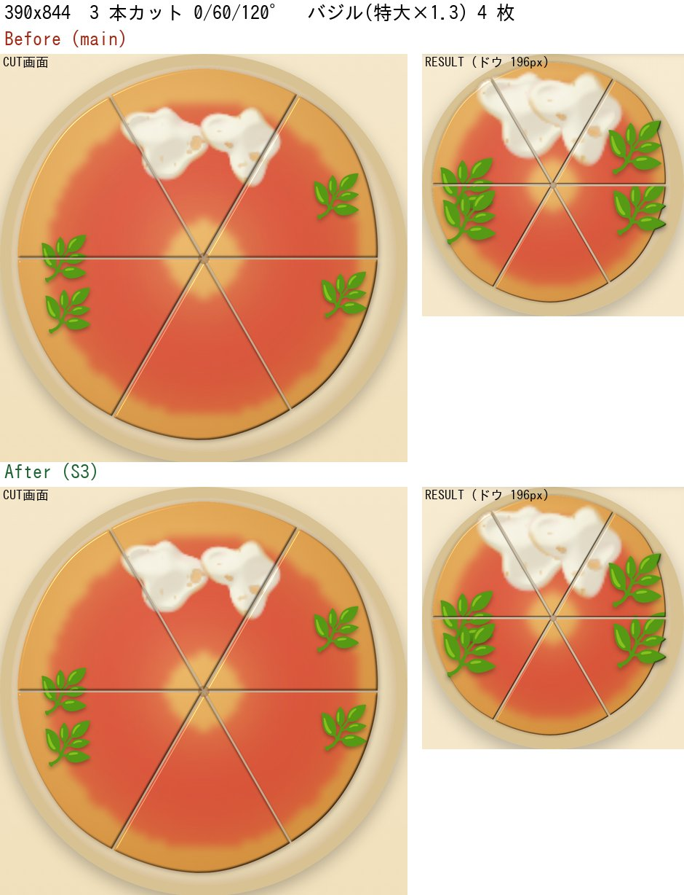
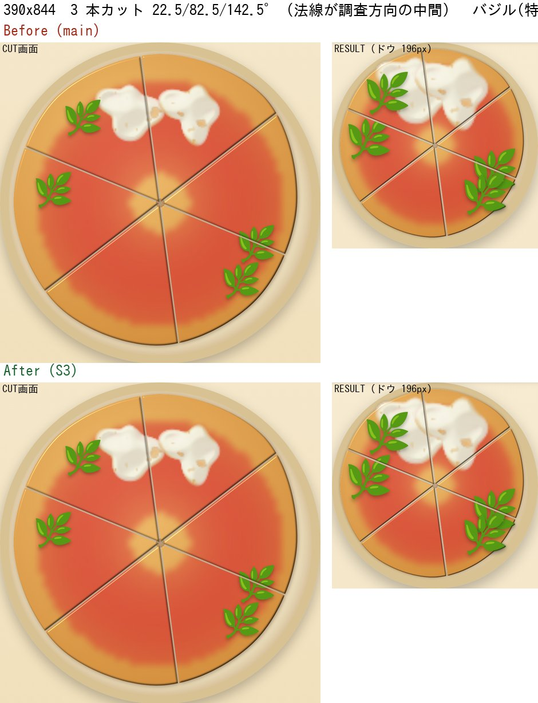
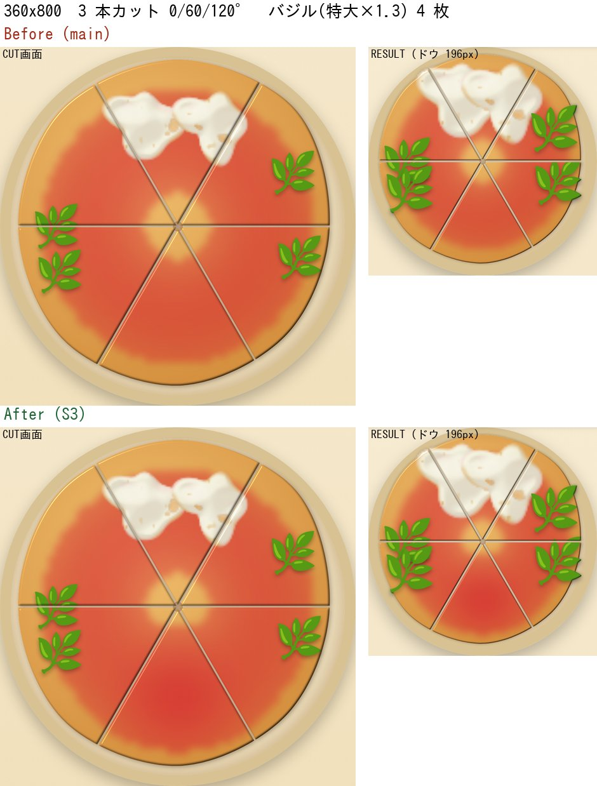
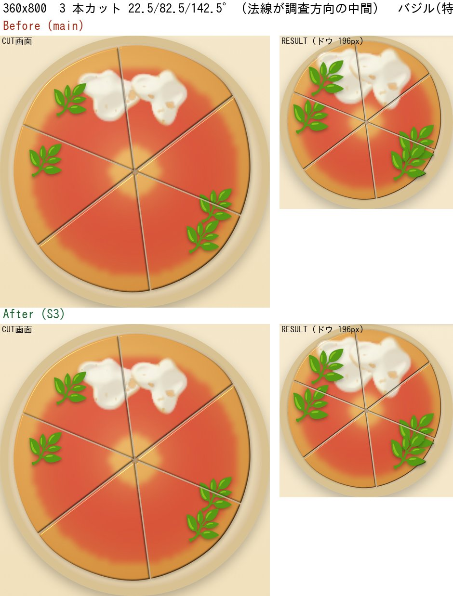

# S3 — CUT・RESULT でカット線をまたぐ食材の欠け修正 — Result

Issue #510（親 #479）。Base: `main` `8c6980e`（#508・#509 マージ後）。監査資料 [`TETO_INGREDIENT-VISUAL-INTEGRATION_CUT-REACH-and-RESULT-SCALE.md`](./TETO_INGREDIENT-VISUAL-INTEGRATION_CUT-REACH-and-RESULT-SCALE.md) の §6 を実装した。**描画のみの変更。採点・保存・CUT の評価・経済・モッツァレラ（Canvas）は変更していない。**

## 問題
切り分けた後、食材のどの部分をどのピースに描くかを、固定の `TOPPING_REACH = 5`（ドウ幅の %）と中心から 8 方向の調査点で決めていた。食材の実寸とドウの描画幅を読まないため、カット線をまたぐ食材が隣のピースに描かれず、線で平らに欠けた。RESULT 画面（ドウ 196px）で目立ち、#508（大 ×1.15 / 特大 ×1.3）で範囲が広がった。8 方向の調査には、法線が調査方向の中間（22.5°）だと届かない、45° 未満の細い楔形に入らない、という弱点もあった。

## 変更
| ファイル | 内容 |
|---|---|
| `src/logic/cut/pieces.ts` | `PizzaPiece.polygon`（直線カットのピースの正確な凸外形、任意）。`placeTopping` は外形が揃っているとき、**食材の外接円とピース外形の厳密な交差判定**で隣のピースを決める。曲線の軌跡（ゲームでは出ない）は従来の 8 方向調査のまま。`distanceToConvexPolygon` を追加 |
| `src/logic/cut/toppingFootprint.ts`（新規） | 外接円の半径。箱 40px（実測の最大 37.3px + 余裕）の対角 × 倍率を、ドウの内側 px（幅 − 20）で % に換算。未測定（0px）は従来の `TOPPING_REACH` |
| `src/components/PizzaStage.tsx` | 食材ごとの `reach` を `toppingFootprintRadiusPercent(倍率, doughPx)` に。**Canvas モッツァレラは既存の `cheesePoolReachPercent` のまま** |
| テスト | `pieces.test.ts`（厳密交差、22.5°、0/60/120°、細い楔、総当たり照合）、`toppingFootprint.test.ts`、`PizzaStage.pieces.test.tsx`（描画、CUT 幅と RESULT 幅）、`e2e/cut-topping-reach-s3.spec.ts`（実ブラウザの DOM 検証と Before/After 撮影）、`e2e/gestures.ts`（`cutThroughCentre`） |

## 検証
- **旧実装では失敗し、新実装では通る**: PizzaStage の 3 テストと e2e 4 件（390 / 360 の 2 シナリオ）。
- **総当たり照合**: 5 通りのカット × 5 通りの reach × 12 位置で、円盤を細かくサンプリングして触れるピースを数え、厳密判定が漏らさないこと、reach より遠いピースを足さないことを確認。
- **細い楔形**: 2 本の近いカット（20° 差）で、旧 8 方向調査が見落とし、厳密判定が拾う位置があることを、旧方式との比較で確認。
- **不要なコピー**: 食材が線から十分離れているとき、コピーは出ない（単体・描画・e2e）。
- **実描画 Before / After**（390×844、360×800、CUT 画面と RESULT、deviceScaleFactor 3。バジル ×1.3 を線から 0 / 9 / 13 / 16% に配置）:

| シナリオ | 画像 |
|---|---|
| 3 本カット 0/60/120°、390×844 |  |
| 22.5/82.5/142.5°、390×844 |  |
| 3 本カット 0/60/120°、360×800 |  |
| 22.5/82.5/142.5°、360×800 |  |

- e2e の期待値（CUT 画面）: 線から 0 / 9% は隣に欠片が出て、13 / 16% は出ない（外接円の半径が約 11〜12% のため）。RESULT: 4 枚とも出る（半径 約 21%）。

## 影響しないこと（確認）
- **採点**: `scoringV2` は `ingredientId` / `x` / `y` だけを読む。差分なし。
- **保存**: `PlacedTopping` に大きさはない。保存・スキーマ差分なし。
- **CUT の評価**: `evaluation.ts` は切断線・領域・幾何のみ。食材を読まない。差分なし。
- **モッツァレラ**: Canvas の描画・サイズ・溶け広がり・`cheesePoolReachPercent` は不変。既存の `PizzaStage.cheeseCanvas` テストが通る。
- **#503（SVG）・RESULT の縮尺・C 案のルッコラ補正**: 含めていない。

## Owner 確認（実機）
iPhone で、バジルが切断線をまたぐ配置（margherita）の CUT 画面と RESULT を見て、線で平らに欠けないことを確認する。360 幅で CUT 画面の欠けが出ないことも見る。

## 残る課題
- 外接円は保守的（箱の対角）で、実際の絵より大きい。余計なコピーは、そのピースの外形でクリップされて何も見えないため無害（DOM の要素が増えるだけ）。
- RESULT 画面で食材が大きく見える問題（食材とドウの比 約 14〜15%）は別スライス（RESULT の縮尺）。
