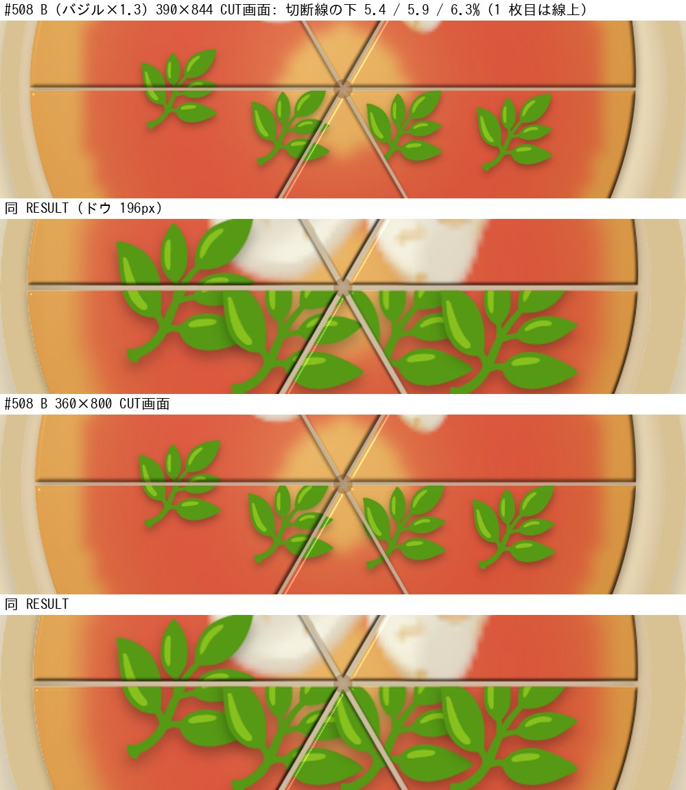
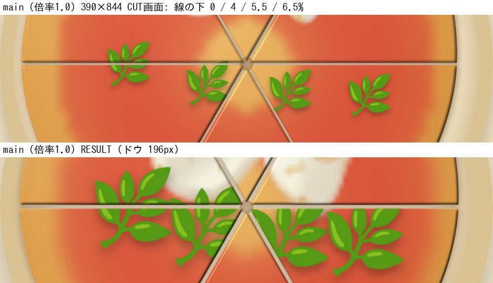

# CUT の当たり範囲と RESULT 縮尺 — 影響調査と #508 マージ前の確認項目

Status: **調査のみ。ゲームのソースコードは変更していない。** Audited: `main` `7ce7307`、PR #508 HEAD `c9669e1`（変更なし）、2026-10-16。
親文書: [`TETO_INGREDIENT-VISUAL-INTEGRATION_Fresh-Audit.md`](./TETO_INGREDIENT-VISUAL-INTEGRATION_Fresh-Audit.md)。関連: Issue #479（S3 = CUT の当たり範囲、D7 / D8 の Owner 決定）、PR #508、PR #507（Canvas モッツァレラ）。

## 0. 結論

1. **CUT の判定・採点は食材の大きさを読まない。** 食材の大きさが関わるのは、切った後の「どの切り分けピースに食材のどの部分を描くか」という**見た目だけ**。
2. その描き分けは固定値 `TOPPING_REACH = 5`（ドウ幅の %）で決まる。**CUT 画面ではおおむね収まるが、RESULT 画面（ドウ 196px）では食材が相対的に大きくなり、切断線をまたぐ食材の上端が平らに切れる。** これは #508 より前の main（倍率 1.0）でも起きる既存の問題で、B 案（大 ×1.15、特大 ×1.3）で範囲と欠けが広がる。
3. 影響を受ける組み合わせは限られる。CUT がある 24 レシピのうち、B で 1.15 倍以上になる具材は **バジル（特大。4 レシピ）、フォンティーナ（大。1 レシピ）、たまご（大。3 レシピ）、ベーコン（大。3 レシピ）** だけ。ルッコラ・生ハム・ほうれん草・フリアリエッリ（特大）は CUT のないレシピにしかなく、切断線が出ないので欠けは起きない。
4. **#508 のマージを止めるほどの新規の不具合ではない**（既存の問題の拡大。CUT 画面では欠けが見えない）。ただし直後に、当たり範囲を実寸連動にする対応（S3）か RESULT の縮尺（§3）を行う。判断は Owner。
5. RESULT の縮尺改善は、**採点・保存データ・CUT の結果に影響しない**（§3）。見た目の CSS と、当たり範囲の計算だけを変える。

## 1. 仕組み（コード根拠、main `7ce7307`）

| 役割 | 場所 | 内容 |
|---|---|---|
| CUT の評価 | `src/logic/cut/evaluation.ts` | 切断線・領域・幾何だけを import（`cutVisual` / `geometry` / `regions` / `doughShape`）。食材の座標・大きさは読まない |
| 採点 | `src/logic/scoringV2/index.ts:358` | `scorePiecesComponentV2(safePizza.toppings, …)`。読むのは `PlacedTopping` の `ingredientId` / `x` / `y` のみ。大きさは持たない |
| 保存 | `src/state/pizzaState.ts`（`PlacedTopping`） | `id` / `ingredientId` / `x` / `y`（と FINISH 用の `stage`、保存しない）。大きさ・倍率は含まれない |
| 切り分けの見た目 | `src/components/PizzaStage.tsx:1130` | `toppingPlacements`: 各食材について `placeTopping(layout, x, y, reach)` を呼び、「中心がいるピース（home）」と「一部がまたぐ隣のピース（halves）」を決める |
| 当たり範囲 | `src/logic/cut/pieces.ts:36` / `:193` | `TOPPING_REACH = 5`。中心から 5%離れた 8 方向を調べ、別のピースに入れば halves に加える |
| モッツァレラだけ別計算 | `src/components/CheesePoolCanvas.tsx:80` | `cheesePoolReachPercent(sizePx, doughPx)`。Canvas の実 px と**実測のドウ幅**から % に換算（#507。RESULT の小さいドウに対応済み） |
| RESULT のドウ幅 | `src/App.css:319` | `.pizza-stage--result .pizza-dough { width: min(58vw, 196px) }`（PR-D） |

つまり、**当たり範囲が実際の食材の半幅より小さいと、またいだ側のピースにその部分が描かれず、切断線で平らに欠ける**。逆に範囲が大きすぎる場合は、またいでいない食材も halves に入るが、クリップ領域に食材のインクがないため見えない（無害）。

## 2. 食材の半幅と当たり範囲（計算）

絵文字の箱は 31px（font-size 28px の行ボックス）。半幅（ドウ幅に対する %）= 15.5 × 倍率 ÷ ドウの内側 px × 100。内側 px = ドウ幅 − 20（枠線）。実際の絵は箱の約 8 割なので、見た目の半幅は括弧内。当たり範囲は 5。

| 倍率（例） | CUT 画面 390×844（ドウ 358px） | CUT 画面 360×800（ドウ 328px） | RESULT（ドウ 196px） |
|---|---|---|---|
| 0.7（極小） | 3.2%（2.6） | 3.5%（2.8） | 6.2%（4.9） |
| 0.85（小） | 3.9%（3.1） | 4.3%（3.4） | 7.5%（6.0） |
| 1.0（中、本番の現状） | 4.6%（3.7） | 5.0%（4.0） | **8.8%（7.0）** |
| 1.15（大） | 5.3%（4.2） | 5.8%（4.6） | **10.1%（8.1）** |
| 1.3（特大） | 6.0%（4.8） | 6.5%（5.2） | **11.4%（9.2）** |
| 1.43（候補 C のほうれん草・ルッコラ） | 6.6%（5.2） | 7.2%（5.8） | 12.6%（10.1） |

読み方:
- **CUT 画面**: 中までは 5 に収まる。大・特大は箱では超えるが、絵（括弧内）では 360 幅の特大（5.2）がわずかに超える程度。
- **RESULT**: 倍率 1.0 の食材でも、絵の半幅が 7.0% で 5 を超える。つまり**今の本番でも、RESULT で切断線から 5〜7%離れた食材は、またぐ部分が欠ける**。B ではその幅が広がる（大 8.1%、特大 9.2%）。

## 3. 実測（実ゲームの描画）

margherita（CUT あり）で、バジルを水平の切断線（y=50）の下に置き、焼成 → 3 本カット → 「切り終わる」。deviceScaleFactor 3。切断線の周辺を切り出した。

**#508 B（バジル ×1.3）**: 切断線の下 5.4 / 5.9 / 6.3%（1 枚目は線上）。

- CUT 画面（390、360 とも）: 欠けは見えない。
- **RESULT: 線から離れた 3 枚のバジルの上端が、切断線で平らに切れている。** 線上の 1 枚は欠けない（中心が範囲 5% 内にあるため、隣のピースにも描かれる）。

**main（倍率 1.0）**: 線の下 0 / 4 / 5.5 / 6.5%。

- RESULT で、線から 5.5% 以上離れたバジルの上端が同様に平らに切れる（既存の問題）。B では欠ける食材の範囲と欠けの大きさが増える。

## 4. #508 のマージ前の確認項目（CUT 当たり範囲）

PR #508 は変更しない。以下は、Owner の実機確認、または別の確認作業で行う項目。

| # | 確認 | 方法 | 合格の目安 |
|---|---|---|---|
| 1 | CUT の判定・採点が不変 | コード上: `evaluation.ts` が食材を読まないこと（本書 §1）。CI: 既存の CUT / 採点テスト（#508 は 9/9 green） | 差分なし |
| 2 | モッツァレラの当たり範囲が main と同じ | #508 はモッツァレラの倍率を 1 に除外（`Math.round(70 × 1) = 70`）。`cheesePoolReachPercent` の入力が main と同一 | main と同じ値 |
| 3 | **CUT 画面でバジル（特大 ×1.3）が欠けない**: margherita、390×844 と 360×800 | 切断線の下 5〜6.5% にバジルを置き、3 本カットして目視。§3 の手順 | 平らな欠けがない。360 幅で 1〜2px の欠けが出た場合は S3 へ |
| 4 | CUT 画面で大（たまご、ベーコン、フォンティーナ）が欠けない | bismarck / breakfast-pizza / pizza-portuguesa（たまご）、meat-lovers / pesto-patate（ベーコン）、quattro-formaggi（フォンティーナ）。同上 | 同上 |
| 5 | RESULT 画面の欠け（既存の問題の拡大）を Owner が許容できるか | §3 の画像と同じ配置で、実機の RESULT を確認 | 許容できれば #508 を先にマージし、S3 / RESULT 縮尺を直後に。許容できなければ S3 を #508 の直前に |
| 6 | 候補 C を Preview で見る場合の追加確認 | `?toppingScale=c`。ほうれん草・ルッコラ（1.43）は CUT のあるレシピに無いので、CUT 上は影響なし | — |
| 7 | #503 のマージ後 | hot-dog / sausage の SVG 化で見た目の半幅が変わる（絵文字の約 0.7〜0.8 倍）。当たり範囲は小さくなる方向で無害 | — |

## 5. RESULT 縮尺の改善案と影響調査

### 5.1 案

RESULT のときだけ、食材の大きさをドウの縮みに合わせる。食材とドウの比は PREPARE 約 10%、CUT 約 8%、RESULT 約 14〜15%。CUT 画面と同じ比にするには倍率 0.55（= 196 ÷ 358）。判読性を考えると 0.7〜0.75 程度が現実的（食材が約 20〜22px、比は約 11%）。倍率は HV で決める。

方式（いずれも CSS 変数。保存しない）:
- 新しい変数 `--piece-phase-scale`（既定 1）を `.pizza-stage--result` で設定し、`--piece-rank-scale` と同じ 3 か所（絵文字の font-size、`.pizza-cheese` の 2 つの transform）に掛ける。
- あわせて当たり範囲を実寸連動にする（§6）。

### 5.2 影響調査

| 対象 | 影響 | 根拠 |
|---|---|---|
| 採点（Scoring 2.0） | **なし** | 読むのは `ingredientId` / `x` / `y`。大きさ・DOM を読まない（`scoringV2/index.ts:358`） |
| CUT の結果（評価・星・点） | **なし** | `evaluation.ts` は切断線と幾何のみ。食材を読まない |
| 保存データ | **なし** | `PlacedTopping` に大きさがない。縮尺は CSS のみで保存対象に出ない。スキーマ変更なし |
| Pitz・経済・Dex | **なし** | 食材の座標と id しか入力にしない |
| ピースの描き分け（見た目） | **改善**。ただし当たり範囲の更新が必要 | 縮小すると半幅が当たり範囲 5 に近づき、§3 の欠けが減る。固定値のままでも害はなく（範囲が大きいのは無害）、完全に解消するには範囲を実寸連動にする |
| モッツァレラ（Canvas） | **Owner 判断** | Canvas の箱は固定 px（70px）で、RESULT ではドウの約 26%。縮尺を掛けない場合、他の食材だけ小さくなりモッツァレラが相対的に大きくなる。掛ける場合は `sizePx` と `cheesePoolReachPercent` の入力を揃える必要がある。「モッツァレラのサイズは変更しない」の制約に反するため、掛けないのが前提 |
| CSS チーズ（`.pizza-cheese--*`）、SVG 専用食材 | 変数を掛ければ同様に縮む | transform と font-size の 3 か所 |
| Reference（見本）・サムネイル | **なし** | `--piece-scale` で別に縮めており、`.pizza-stage--result` 内の PizzaStage にだけ新しい変数を設定すれば影響しない |
| `.pizza-stage--result` の使用箇所 | RESULT の主役ピザのみ | `PizzaStage` の `resultCompact`（`App.css:319`、`stageLayout` テスト）。PREPARE / BAKE / CUT は対象外 |
| 既存テスト | **更新が必要** | `pieceRankScale.test.tsx` の「stylesheet」系テストが font-size / transform の式を文字列で固定している。変数を足すと期待値の更新が要る。本番 DOM ゴールデンは、変数をクラス経由（CSS）で設定する限り DOM に出ず影響しない |
| iPhone 実機 | 要確認 | 360 幅での判読性（縮小後の食材 20px 前後）、RESULT の他の要素（ボタン等）との位置関係は変わらない（ドウの大きさを変えない） |

### 5.3 リスク

- 小さくしすぎると、RESULT で食材が判別できなくなる（特に極小の葉）。倍率は HV で決める。
- RESULT にしか出ない問題を直すため、PREPARE・CUT の見た目は変わらない。範囲は限定的。

## 6. S3: 当たり範囲を実寸連動にする案（Owner 決定 D7 の具体化）

現状は「固定 5%（モッツァレラだけ実寸）」で、`placeTopping`（`pieces.ts:193`）は中心から 8 方向（45° 刻み）の 8 点だけを調べる。この方式には、半径を実寸にしても残る弱点が 2 つある。

1. **法線が調査方向の中間にあるとき**: 切断線の法線が 2 つの調査方向のちょうど中間（22.5°）にあると、調査点の投影は reach × cos 22.5° ≈ 0.924 倍にしかならない。例: 半幅 8.8% を `ceil` した reach = 9 でも、調査点は線に対して 8.31% までしか届かず、8.5% で線をまたぐ食材の隣のピースには半分が出ない（現行の固定 5 も同じ）。
2. **細い楔形のピース**: プレイヤーが近い 2 本の線を引くと、角度が 45° より狭いピースができる。その楔の方向が調査点のどれにも当たらないと、食材がそのピースに食い込んでいても 8 点のどれも入らず、そのピースの欠片が描かれない。reach をどれだけ大きくしても直らない。

**したがって、実装の第一候補は「食材の外形と各ピースの厳密な交差判定」とする。** ピースは `computeCutRegions`（`regions.ts`）が返す凸領域なので、外形を円（半径 = 半幅）とみなした「円と凸多角形の交差」で判定できる。調査点の数や角度に依存しないため、上の 2 つが同時に解決する。

- **外形の半径は、描画される形をすべて含む保守的な外接円にする**（半幅ではなく）。描画の種類ごとに、角と変形まで含めて決める。

  | 描画 | 外接円の半径（px） | 注意 |
  |---|---|---|
  | 絵文字 / SVG 食材（正方形の箱 31px = 1em の行ボックス） | 15.5 × √2 × 倍率 × 画面ごとの縮尺 ≈ 21.9 × 倍率 × 縮尺 | 絵が箱の角に伸びる食材（バジルの枝先など）でも箱の外にははみ出さない。半幅（15.5）の円は角を含まない |
  | CSS チーズ（`.pizza-cheese--*`） | 形の最大寸法の外接円 × `--bake-melt-scale` の**最大値（焼成中の最大）** × 倍率 × 縮尺 | 焼成で広がる分を含める（transform は CSS 側で拡大される） |
  | Canvas モッツァレラ | 既存の `cheesePoolReachPercent`（箱の半幅 × (1 + 溶けの広がり)） | 既に溶けの広がりを含む。箱の角は透明余白で、必要なら √2 を掛ける |
  | ドウ内側 px への換算 | 半径 px ÷ ドウ内側 px × 100 | ドウ内側 = ドウ幅 − 20 |

  外接円は食材の実際のインクより大きく、**過大な見積もりは無害**（§1）。小さすぎる見積もりだけが欠けを生む。
- 範囲を超えて大きく見積もるのは無害（§1）。**小さすぎると欠ける**ので、安全側に倒す。
- 暫定案（厳密判定を入れない場合のみ）: reach を 1 ÷ cos 22.5° ≈ 1.082 倍して切り上げる。これは弱点 1 しか解消しない。細い楔（弱点 2）が残ることを、仕様に明記する。調査方向を増やす（適応的な角度サンプリング）案もあるが、判定の確実さは厳密な交差判定に劣る。
- 描画専用。CUT の評価・採点・保存は変更しない（§5.2）。
- **テスト**: `placeTopping`（または後継の関数）の単体テストに次を含める。(a) 特大・RESULT の幅で隣のピースに halves が出る。(b) 法線が 22.5° の斜めカットで、半幅ぎりぎりの食材に halves が出る。(c) 0° / 60° / 120° の 3 本カット。(d) **45° より狭い楔形のピース**（近い 2 本のカットで作る）に食い込む食材の欠片が描かれる。(e) 食材が線から十分離れているとき、余計な halves が出ない。(f) **箱の角だけが細い楔に入るケース**（半幅の円では入らず、外接円では入る位置）と、**焼成で広がった CSS チーズ**（`--bake-melt-scale` が最大のとき）が隣のピースに出る。`PizzaStage` の描画テストで、CUT 画面と RESULT の両方を確認する。
- 実機 HV: §4 の項目 3〜5 に加え、近い 2 本のカットで細い楔を作り、食材の欠けがないことを見る。

実装単位の位置づけ: 親文書 §7 の単位 1（S3）と単位 8（RESULT の縮尺）。両方を一度に行うと、欠けの解消と比の改善が揃う。

## 7. 限界

- 実測は margherita のバジルのみ（特大）。大（たまご、ベーコン、フォンティーナ）の実描画は未確認。
- 半幅の計算は絵文字の箱（31px）に基づく推定。iPhone の Apple Color Emoji では絵の大きさが違う。
- SVG に替わった食材（#503 後の hot-dog / sausage）の半幅は未測定。
