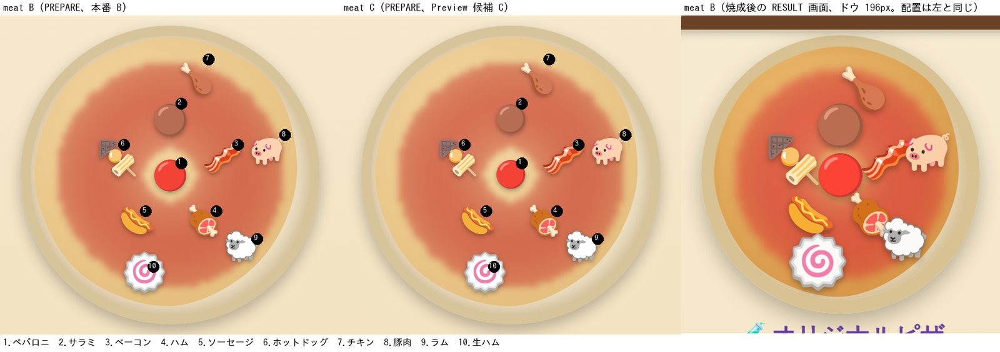
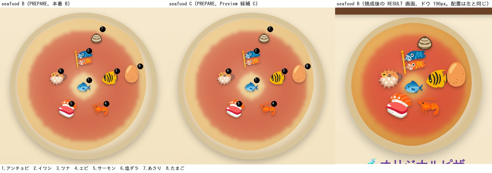
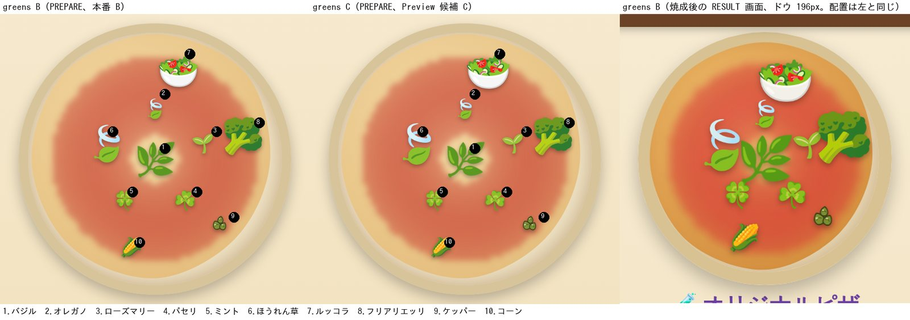
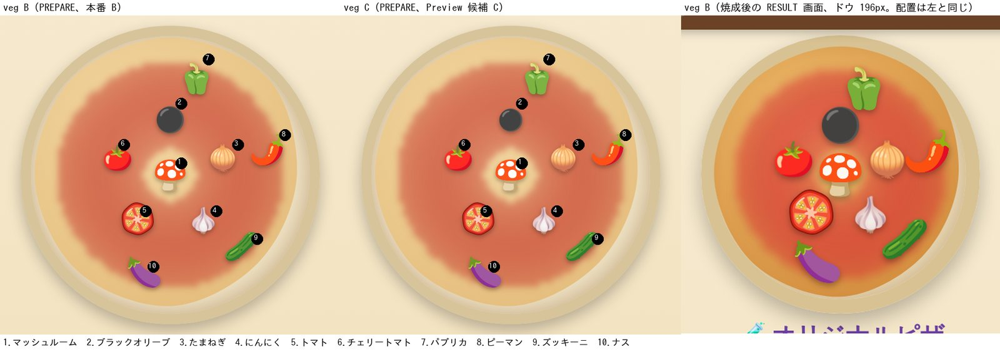
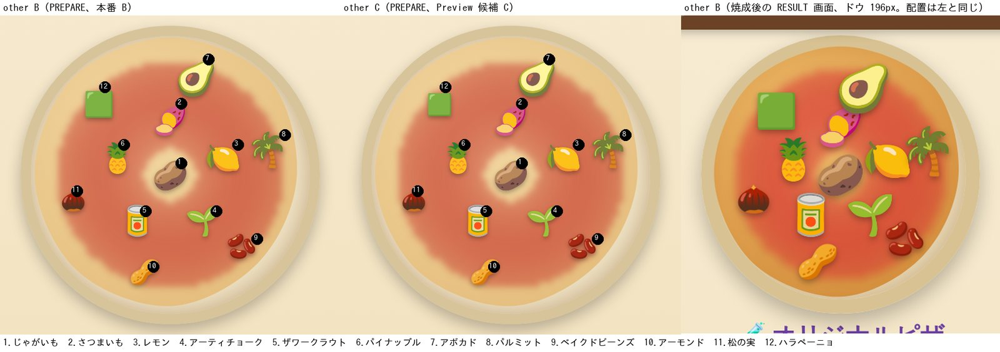
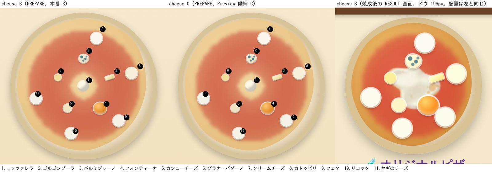
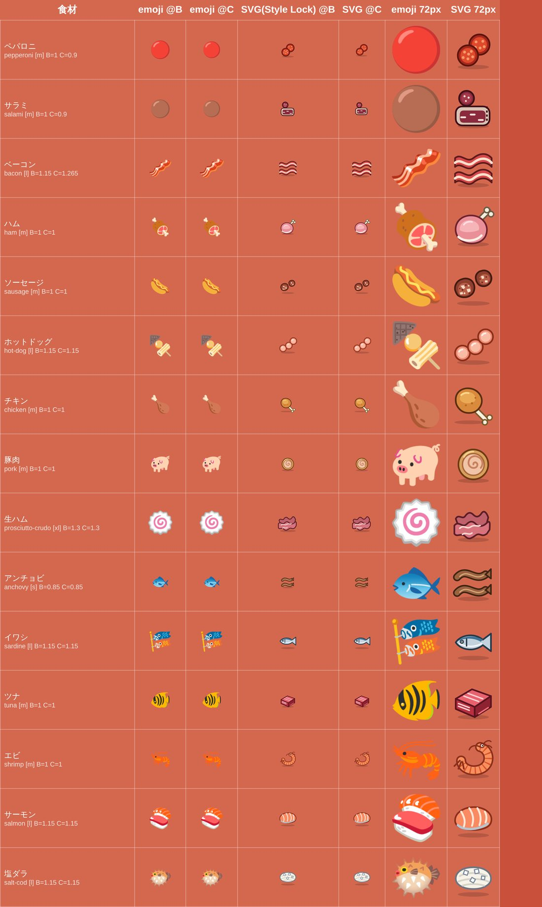
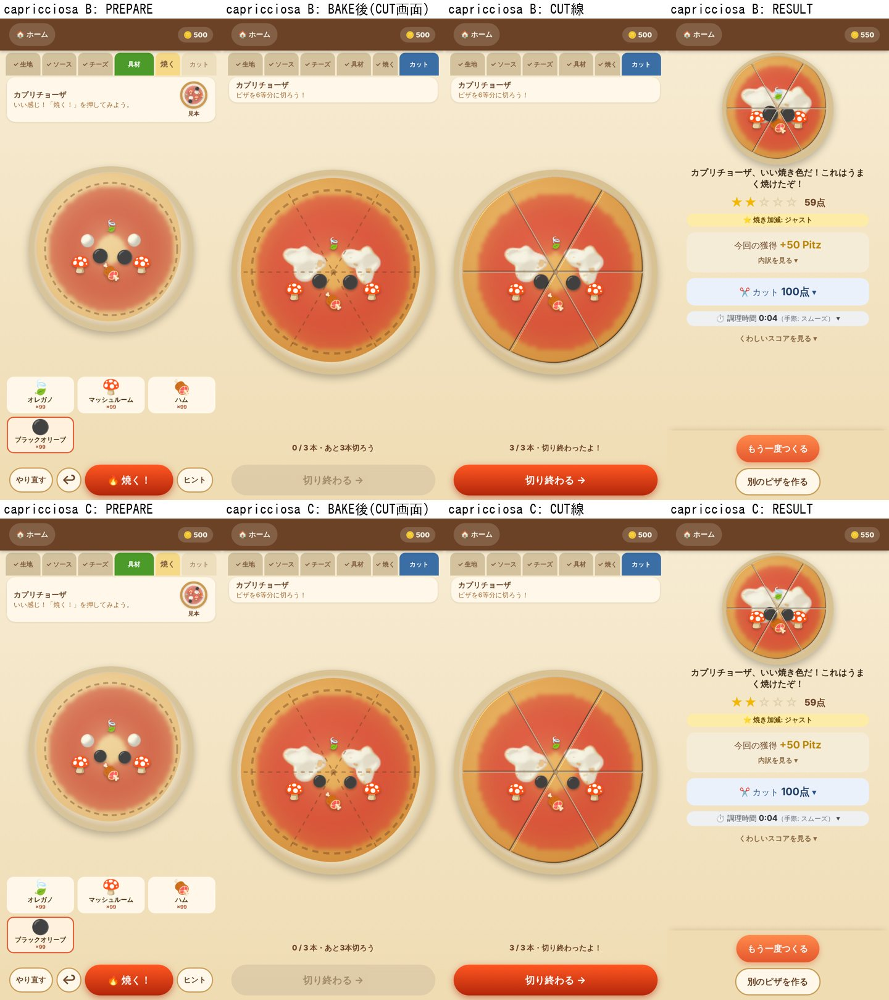
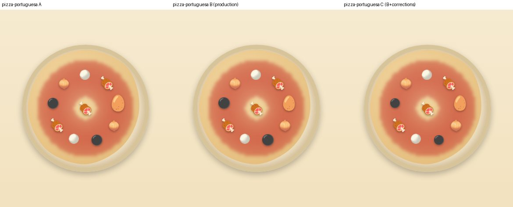

# 食材ビジュアル統合改善 — Fresh Audit と実装計画

Status: **調査・設計・比較資料のみ。ゲームのソースコードは変更していない。** 本書は設計 authority ではなく、Owner 判断の材料である。
Audited: `main` `7ce7307`（#507 まで）、PR #508 HEAD `c9669e1`、PR #503 HEAD `ca5f1c3`、2026-10-16。
関連: 本書の姉妹文書 [`TETO_INGREDIENT-VISUAL-INTEGRATION_CUT-REACH-and-RESULT-SCALE.md`](./TETO_INGREDIENT-VISUAL-INTEGRATION_CUT-REACH-and-RESULT-SCALE.md)（CUT の当たり範囲と RESULT 縮尺の影響調査）。

## 0. 目的と制約

食材アイコンの差し替え、トッピングのサイズ、完成ピザの配置・焼き上がりの見栄えを、一体で改善する計画を作る。

守ったこと:
- ゲームのソース、PR #503・#508 は変更していない。#508 の HEAD は `c9669e1` のまま。
- モッツァレラ（Canvas のサイズ・溶け広がり）、採点、保存、経済、CUT の判定、ドラッグ操作は対象外。
- **Style Lock v2（`docs/decisions/TETO_INGREDIENT-ICON-2.0_STYLE-LOCK-V2.md`）を尊重**し、変更しない。新規アイコンの生成・採用は別工程であり、本書は「新規デザインが必要な食材の一覧」までに留める。
- 比較画像は実ゲームの描画、またはリポジトリ内の実 SVG のみ。AI 生成の架空画面は使っていない。
- 新しい Issue は作っていない（§1）。

## 1. 既存 Issue / PR との関係（重複を作らない）

| 項目 | 状態 | 本書との関係 | 本書がやらないこと |
|---|---|---|---|
| Issue #417（親）/ **#438**（Pilot A 実装） | open | アイコン差し替えの実装計画はここにある。本書は「サイズ補正との接続」と、Style Lock の対象外の食材の一覧を #438 側へ渡す資料 | 新しい Issue の起票、Pilot の対象・順序の変更 |
| **PR #503**（Pilot A: hot-dog / sausage / feta / ricotta） | open、head `ca5f1c3`。main と競合なし、#508 とのファイル重複なし | 差し替え後のサイズ補正（hot-dog ×1.35、sausage ×1.40）の根拠を §3 に追加 | PR の変更、マージ順の指定 |
| Issue **#479** / **PR #508**（S2c） | #508 open、CI 9/9、Codex 指摘なし | 本書は #508 の後続設計。#508 への推奨は §7 と姉妹文書 | #508 の HEAD の変更 |
| PR #468 / #507 | #507 は merged（Canvas モッツァレラの溶け広がり）。#468 は open のまま HOLD | モッツァレラは一切変更しない | — |
| PR #478（draft） | ドラッグ操作の統一 | 対象外 | — |
| #294 / #504（FINISH エンジン） | 純粋層。`applicationPhase` は型のみで、現行レシピは未使用 | 生の葉物を焼成後に載せる案との接点（§6 の単位 7） | 配線 |
| #186（closed）/ #37 | 焼き色の連続カーブは実装済み | 焼成表現はこれを土台にする | — |

Style Lock v2 §9.6: オレガノ/ほうれん草（🍃）、アーティチョーク/ローズマリー（🌱）の絵文字の重複は、Owner 決定により本アイコン 2.0 の対象外（HV 通過済み）。**本書ではこの 4 食材のアイコン差し替えを提案しない。** 先に共有した作業用の Artifact 版ではほうれん草を「新規デザイン」に挙げていたが、この決定に反するため、本書で取り下げる（サイズ調整のみ）。

## 2. 61 材料の監査表

具材 50 + チーズ 11。ソース 3 種（スプレッド）は対象外。データは [`TETO_INGREDIENT-VISUAL-INTEGRATION_inventory-61.csv`](./data/TETO_INGREDIENT-VISUAL-INTEGRATION_inventory-61.csv)。

- 「クラス」は S1 のサイズ分類（極小 xs / 小 s / 中 m / 大 l / 特大 xl）。B は本番候補（PR #508）の倍率、C は Preview 限定の補正候補。
- 「実効」は、絵文字の中身（インク面積）まで含めた見た目の大きさ。クラス中の「中」の絵文字の中央値を 1.0 とした推定（Chromium + Noto Color Emoji）。目標は B のクラス値（0.7 / 0.85 / 1.0 / 1.15 / 1.3）。専用 SVG とチーズは対象外（—）。
- 「判定」: **現状維持 / サイズ調整 / Style Lock アイコン / 新規デザイン / 描画方式変更**。

| id | 名前 | ピザ上の描画 | クラス | B | C | 実効 B | 実効 C | レシピ数 | 判定 | 備考 |
|---|---|---|---|---|---|---|---|---|---|---|
| `mozzarella` | モッツァレラ | Canvas 🧀 | l | 1 | 1 | — | — | 39 | 現状維持 | Canvas。サイズ・溶融は変更しない（倍率 1 に除外） |
| `gorgonzola` | ゴルゴンゾーラ | CSS形状 🧀 | m | 1 | 1 | — | — | 1 | 現状維持 | ピザ上は CSS 形状。アイコンは Style Lock（アイコン用途のみ） |
| `parmigiano` | パルミジャーノ | CSS形状 🧀 | s | 0.85 | 0.85 | — | — | 4 | 現状維持 | ピザ上は CSS 形状。アイコンは Style Lock（アイコン用途のみ） |
| `fontina` | フォンティーナ | CSS形状 🧀 | l | 1.15 | 1.15 | — | — | 1 | 現状維持 | ピザ上は CSS 形状。アイコンは Style Lock（アイコン用途のみ） |
| `basil` | バジル | 絵文字 🌿 | xl | 1.3 | 1.3 | 1.26 | 1.26 | 4 | 現状維持 |  |
| `garlic` | にんにく | 絵文字 🧄 | s | 0.85 | 0.85 | 0.76 | 0.77 | 6 | 現状維持 |  |
| `oregano` | オレガノ | 絵文字 🍃 | xs | 0.7 | 0.7 | 0.54 | 0.54 | 8 | サイズ調整 | fit 約 1.3。🍃 重複は §9.6 で対象外 |
| `cherry-tomato` | チェリートマト | 絵文字 🍅 | s | 0.85 | 0.85 | 0.93 | 0.93 | 1 | 現状維持 |  |
| `egg` | たまご | 絵文字 🥚 | l | 1.15 | 1.15 | 1.18 | 1.18 | 5 | 現状維持 | 卵の専用描画は #479 の Owner 決定どおり独立 Issue 候補 |
| `mushroom` | マッシュルーム | 絵文字 🍄 | m | 1 | 1 | 1.09 | 1.09 | 4 | 新規デザイン(高) | 🍄 は赤い毒キノコ。サイズは適正 |
| `onion` | たまねぎ | 絵文字 🧅 | s | 0.85 | 0.85 | 0.9 | 0.9 | 10 | 現状維持 |  |
| `sausage` | ソーセージ | 絵文字 🌭 | m | 1 | 1 | 0.95 | 0.95 | 6 | Style Lock アイコン(Pilot A / #503) | #503 open。差し替え時の補正 x1.4 / x1.35 |
| `pepperoni` | ペパロニ | 絵文字 🔴 | m | 1 | 0.9 | 1.19 | 1.07 | 2 | サイズ調整(暫定)+Style Lock アイコン | fit 0.84〜0.9。SVG 差し替え時に外し、x1.4〜1.6 が必要 |
| `anchovy` | アンチョビ | 絵文字 🐟 | s | 0.85 | 0.85 | 0.72 | 0.72 | 2 | Style Lock アイコン | 差し替え時にサイズ補正を設定 |
| `tuna` | ツナ | 絵文字 🐠 | m | 1 | 1 | 1.03 | 1.03 | 3 | Style Lock アイコン | 差し替え時にサイズ補正を設定 |
| `rosemary` | ローズマリー | 絵文字 🌱 | xs | 0.7 | 0.7 | 0.57 | 0.57 | 4 | サイズ調整 | fit 約 1.2。🌱 重複は §9.6 で対象外 |
| `bacon` | ベーコン | 絵文字 🥓 | l | 1.15 | 1.265 | 0.87 | 0.96 | 7 | サイズ調整(暫定)+Style Lock アイコン | fit 1.1〜1.3。SVG は同じインク量（補正不要） |
| `ham` | ハム | 絵文字 🍖 | m | 1 | 1 | 1.0 | 1.0 | 6 | Style Lock アイコン | 差し替え時にサイズ補正を設定 |
| `black-olive` | ブラックオリーブ | 絵文字 ⚫ | s | 0.85 | 0.722 | 1.01 | 0.86 | 10 | サイズ調整+新規デザイン(高) | fit 0.84。平らな黒丸。リング切りの SVG は Style Lock 対象外 |
| `capers` | ケッパー | 専用SVG(caper-cluster) 🟢 | xs | 0.7 | 0.7 | — | — | 1 | 現状維持 | 専用 SVG（既存） |
| `clam` | あさり | 専用SVG(clam-valve) 🦪 | s | 0.85 | 0.85 | — | — | 2 | 現状維持 | 専用 SVG（既存） |
| `corn` | コーン | 絵文字 🌽 | xs | 0.7 | 0.7 | 0.74 | 0.74 | 2 | 現状維持 |  |
| `eggplant` | ナス | 絵文字 🍆 | m | 1 | 1 | 0.93 | 0.93 | 6 | 現状維持 |  |
| `fresh-tomato` | トマト | 専用SVG(tomato-slice) 🍅 | m | 1 | 1 | — | — | 7 | 現状維持 | 専用 SVG（既存） |
| `pineapple` | パイナップル | 絵文字 🍍 | m | 1 | 1 | 0.9 | 0.9 | 2 | 現状維持 |  |
| `potato` | じゃがいも | 絵文字 🥔 | m | 1 | 1 | 1.1 | 1.1 | 1 | 現状維持 |  |
| `chicken` | チキン | 絵文字 🍗 | m | 1 | 1 | 0.85 | 0.85 | 1 | Style Lock アイコン | 差し替え時にサイズ補正を設定 |
| `shrimp` | エビ | 絵文字 🦐 | m | 1 | 1 | 0.82 | 0.82 | 1 | Style Lock アイコン | 差し替え時にサイズ補正を設定 |
| `parsley` | パセリ | 絵文字 ☘️ | xs | 0.7 | 0.7 | 0.67 | 0.67 | 2 | 現状維持 | 🍀/☘️ はハーブに見えにくい。新規デザイン候補（優先低・未決） |
| `bell-pepper` | パプリカ | 絵文字 🫑 | m | 1 | 1 | 0.95 | 0.95 | 3 | 現状維持 |  |
| `zucchini` | ズッキーニ | 絵文字 🥒 | m | 1 | 1 | 0.87 | 0.87 | 3 | 現状維持 |  |
| `almond` | アーモンド | 絵文字 🥜 | s | 0.85 | 0.85 | 0.83 | 0.82 | 1 | 現状維持 |  |
| `pine-nuts` | 松の実 | 絵文字 🌰 | xs | 0.7 | 0.7 | 0.76 | 0.76 | 1 | 現状維持 |  |
| `prosciutto-crudo` | 生ハム | 絵文字 🍥 | xl | 1.3 | 1.3 | 1.49 | 1.48 | 3 | Style Lock アイコン | 差し替え時にサイズ補正を設定 |
| `green-pepper` | ピーマン | 絵文字 🌶️ | m | 1 | 1 | 0.85 | 0.85 | 1 | 新規デザイン(中) | 🌶️ は赤い唐辛子 |
| `cashew-cheese` | カシューチーズ | CSS形状 🧀 | s | 0.85 | 0.85 | — | — | 1 | 描画方式変更(候補) | ピザ上が色違いの汎用円。Style Lock §4.4 では CSS のまま。個別形状は Owner 判断 |
| `salami` | サラミ | 絵文字 🟤 | m | 1 | 0.9 | 1.19 | 1.07 | 1 | サイズ調整(暫定)+Style Lock アイコン | fit 0.84〜0.9。SVG 差し替え時に外し、x1.4〜1.6 が必要 |
| `arugula` | ルッコラ | 絵文字 🥗 | xl | 1.3 | 1.43 | 1.36 | 1.49 | 3 | サイズ維持(x1.0)+新規デザイン(高) | C の x1.1 は逆効果。🥗 はサラダボウル |
| `grana-padano` | グラナ・パダーノ | CSS形状 🧀 | xs | 0.7 | 0.7 | — | — | 1 | 描画方式変更(候補) | ピザ上が色違いの汎用円。Style Lock §4.4 では CSS のまま。個別形状は Owner 判断 |
| `cream-cheese` | クリームチーズ | CSS形状 🧀 | l | 1.15 | 1.15 | — | — | 3 | 描画方式変更(候補) | ピザ上が色違いの汎用円。Style Lock §4.4 では CSS のまま。個別形状は Owner 判断 |
| `lemon` | レモン | 絵文字 🍋 | m | 1 | 1 | 1.05 | 1.05 | 1 | 現状維持 |  |
| `salmon` | サーモン | 絵文字 🍣 | l | 1.15 | 1.15 | 1.3 | 1.3 | 2 | Style Lock アイコン | 差し替え時にサイズ補正を設定 |
| `salt-cod` | 塩ダラ | 絵文字 🐡 | l | 1.15 | 1.15 | 1.08 | 1.08 | 1 | Style Lock アイコン | 差し替え時にサイズ補正を設定 |
| `baked-beans` | ベイクドビーンズ | 絵文字 🫘 | s | 0.85 | 0.85 | 0.83 | 0.83 | 1 | 現状維持 |  |
| `palm-heart` | パルミット | 絵文字 🌴 | l | 1.15 | 1.15 | 0.96 | 0.95 | 1 | 新規デザイン(低) | 🌴/🥫 |
| `sauerkraut` | ザワークラウト | 絵文字 🥫 | m | 1 | 1 | 1.02 | 1.02 | 1 | 新規デザイン(低) | 🌴/🥫 |
| `pork` | 豚肉 | 絵文字 🐖 | m | 1 | 1 | 1.05 | 1.05 | 1 | Style Lock アイコン | 差し替え時にサイズ補正を設定 |
| `friarielli` | フリアリエッリ | 絵文字 🥦 | xl | 1.3 | 1.3 | 1.51 | 1.52 | 1 | 現状維持 |  |
| `catupiry` | カトゥピリ | CSS形状 🧀 | l | 1.15 | 1.15 | — | — | 1 | 描画方式変更(候補) | ピザ上が色違いの汎用円。Style Lock §4.4 では CSS のまま。個別形状は Owner 判断 |
| `jalapeno` | ハラペーニョ | 絵文字 🟩 | s | 0.85 | 0.722 | 1.14 | 0.97 | 1 | サイズ調整+新規デザイン(低) | fit 0.75〜0.85。🟩 は平らな緑の四角 |
| `feta` | フェタ | CSS形状 🧀 | l | 1.15 | 1.15 | — | — | 1 | 描画方式変更(候補) | ピザ上が色違いの汎用円。Style Lock §4.4 では CSS のまま。個別形状は Owner 判断 |
| `sardine` | イワシ | 絵文字 🎏 | l | 1.15 | 1.15 | 1.13 | 1.13 | 1 | Style Lock アイコン | 差し替え時にサイズ補正を設定 |
| `ricotta` | リコッタ | CSS形状 🧀 | l | 1.15 | 1.15 | — | — | 2 | 描画方式変更(候補) | ピザ上が色違いの汎用円。Style Lock §4.4 では CSS のまま。個別形状は Owner 判断 |
| `hot-dog` | ホットドッグ | 絵文字 🍢 | l | 1.15 | 1.15 | 1.08 | 1.08 | 1 | Style Lock アイコン(Pilot A / #503) | #503 open。差し替え時の補正 x1.4 / x1.35 |
| `avocado` | アボカド | 絵文字 🥑 | l | 1.15 | 1.15 | 1.28 | 1.28 | 1 | 現状維持 |  |
| `goat-cheese` | ヤギのチーズ | CSS形状 🧀 | l | 1.15 | 1.15 | — | — | 1 | 描画方式変更(候補) | ピザ上が色違いの汎用円。Style Lock §4.4 では CSS のまま。個別形状は Owner 判断 |
| `artichoke` | アーティチョーク | 絵文字 🌱 | m | 1 | 1 | 0.81 | 0.81 | 1 | 現状維持 | 🌱 の重複は Style Lock §9.6 で対象外 |
| `spinach` | ほうれん草 | 絵文字 🍃 | xl | 1.3 | 1.43 | 1.0 | 1.1 | 1 | サイズ調整 | fit 1.1〜1.3。🍃 重複は §9.6 で対象外（アイコンは再提案しない） |
| `mint` | ミント | 絵文字 🍀 | xs | 0.7 | 0.7 | 0.66 | 0.66 | 1 | 現状維持 | 🍀/☘️ はハーブに見えにくい。新規デザイン候補（優先低・未決） |
| `lamb` | ラム | 絵文字 🐑 | m | 1 | 1 | 1.11 | 1.11 | 1 | 現状維持 |  |
| `sweet-potato` | さつまいも | 絵文字 🍠 | m | 1 | 1 | 0.99 | 0.99 | 1 | 現状維持 |  |

### 判定の件数

| 判定 | 件数 |
|---|---|
| 現状維持 | 29 |
| Style Lock アイコン | 10 |
| 描画方式変更(候補) | 7 |
| サイズ調整 | 3 |
| サイズ調整(暫定)+Style Lock アイコン | 3 |
| Style Lock アイコン(Pilot A / #503) | 2 |
| 新規デザイン(低) | 2 |
| 新規デザイン(高) | 1 |
| サイズ調整+新規デザイン(高) | 1 |
| 新規デザイン(中) | 1 |
| サイズ維持(x1.0)+新規デザイン(高) | 1 |
| サイズ調整+新規デザイン(低) | 1 |
| 合計 | 61 |

### 絵文字の問題（実描画で確認）

- **意味のずれ**: ホットドッグ=🍢（おでん）、ソーセージ=🌭、マッシュルーム=🍄（赤い毒キノコ）、ピーマン=🌶️（赤い唐辛子）、ルッコラ=🥗（サラダボウル）、塩ダラ=🐡（フグ）、イワシ=🎏（鯉のぼり）、ツナ=🐠（熱帯魚）、生ハム=🍥（なると）、パルミット=🌴、ザワークラウト=🥫。
- **平らな幾何学形**: ペパロニ🔴、サラミ🟤、ハラペーニョ🟩、ブラックオリーブ⚫。他の絵文字が影つきの絵なので、ボタンのように浮く。
- **同じ絵の再利用**: 🧀 ×11、🍃（オレガノ/ほうれん草）、🍅（チェリートマト/トマト）、🌱（ローズマリー/アーティチョーク）。B 案ではオレガノ（極小）とほうれん草（特大）がサイズ差で区別できる。
- **焼成**: 具材は色フィルタだけが変わる（明るさ 1→0.78、セピア 0→0.2 が上限）。ハーブ 5 種は緩やかなカーブ。ほうれん草・ルッコラ・フリアリエッリは肉と同じ褐変カーブ。チーズだけ形が変わり、モッツァレラは焼成後にプール状に広がる（保持対象）。

実描画の比較画像（左から B、C、焼成後の RESULT 画面）:

| グループ | 画像 |
|---|---|
| 肉 10 種 |  |
| 魚介・卵 8 種 |  |
| 葉物・ハーブ・ケッパー・コーン 10 種 |  |
| 野菜 10 種 |  |
| その他 12 種 |  |
| チーズ 11 種 |  |

## 3. Style Lock v2 との対応表

Style Lock v2 は 27 種（確定 8 + 残り 17 + goat-cheese）の SVG を承認済み。既存の専用 SVG 3 種（fresh-tomato / capers / clam）は対象外または維持。

**見た目のサイズ**: 参照 SVG は 64×64 の viewBox を 1em で描くため、同じ font-size だと絵文字より小さく見える。「SVG の見た目 / 絵文字」はインク面積の線形比（SVG ÷ 絵文字。接地影は除く）、「必要な補正」はその逆数。**アイコンを差し替えたら、絵文字向けのサイズ補正は外し、この補正に置き換える**（#503 の HV 項目「サイズ補正の要否」の根拠）。

| id | 名前 | Style Lock の区分 | pieceVisual（案） | Pilot | 実装状況 | SVG の見た目 / 絵文字 | 必要な補正 |
|---|---|---|---|---|---|---|---|
| `mozzarella` | モッツァレラ | 確定8 | `mozzarella-ball` | Pilot C | 未実装 | — | —（チーズはピザ上が CSS のためサイズに影響しない） |
| `gorgonzola` | ゴルゴンゾーラ | 確定8 | `gorgonzola-wedge` | Pilot B | 未実装 | — | —（チーズはピザ上が CSS のためサイズに影響しない） |
| `parmigiano` | パルミジャーノ | 確定8 | `parmigiano-chunk` | Pilot B | 未実装 | — | —（チーズはピザ上が CSS のためサイズに影響しない） |
| `fontina` | フォンティーナ | 残り17 | `fontina-wedge` | 未割当 | 未実装 | — | —（チーズはピザ上が CSS のためサイズに影響しない） |
| `sausage` | ソーセージ | 確定8 | `sausage-slices` | Pilot A | PR #503（open）で実装中 | 0.71 | x1.41 |
| `pepperoni` | ペパロニ | 残り17 | `pepperoni-slices` | 未割当 | 未実装 | 0.62 | x1.61 |
| `anchovy` | アンチョビ | 残り17 | `anchovy-fillets` | 未割当 | 未実装 | 0.85 | x1.18 |
| `tuna` | ツナ | 残り17 | `tuna-block` | 未割当 | 未実装 | 0.75 | x1.33 |
| `bacon` | ベーコン | 残り17 | `bacon-strips` | 未割当 | 未実装 | 1.05 | x0.95 |
| `ham` | ハム | 残り17 | `ham-leg` | 未割当 | 未実装 | 0.83 | x1.20 |
| `capers` | ケッパー | 既存(対象外) | `caper-cluster` | 既存 | 実装済み（既存 32×32） | — | —（チーズはピザ上が CSS のためサイズに影響しない） |
| `clam` | あさり | 既存維持 | `clam-valve` | 既存 | 実装済み（既存 32×32） | — | —（チーズはピザ上が CSS のためサイズに影響しない） |
| `fresh-tomato` | トマト | 既存(対象外) | `tomato-slice` | 既存 | 実装済み（既存 32×32） | — | —（チーズはピザ上が CSS のためサイズに影響しない） |
| `chicken` | チキン | 残り17 | `chicken-drumstick` | 未割当 | 未実装 | 0.88 | x1.14 |
| `shrimp` | エビ | 残り17 | `shrimp-curl` | 未割当 | 未実装 | 0.88 | x1.14 |
| `prosciutto-crudo` | 生ハム | 残り17 | `prosciutto-ribbon` | 未割当 | 未実装 | 0.68 | x1.47 |
| `cashew-cheese` | カシューチーズ | 残り17 | `cashew-cheese-wheel` | 未割当 | 未実装 | — | —（チーズはピザ上が CSS のためサイズに影響しない） |
| `salami` | サラミ | 残り17 | `salami-log` | 未割当 | 未実装 | 0.7 | x1.43 |
| `grana-padano` | グラナ・パダーノ | 確定8 | `grana-slab` | Pilot B | 未実装 | — | —（チーズはピザ上が CSS のためサイズに影響しない） |
| `cream-cheese` | クリームチーズ | 残り17 | `cream-cheese-block` | 未割当 | 未実装 | — | —（チーズはピザ上が CSS のためサイズに影響しない） |
| `salmon` | サーモン | 残り17 | `salmon-fillet` | 未割当 | 未実装 | 0.68 | x1.47 |
| `salt-cod` | 塩ダラ | 残り17 | `salt-cod-fillet` | 未割当 | 未実装 | 0.78 | x1.28 |
| `pork` | 豚肉 | 残り17 | `porchetta-roll` | 未割当 | 未実装 | 0.75 | x1.33 |
| `catupiry` | カトゥピリ | 残り17 | `catupiry-swirl` | 未割当 | 未実装 | — | —（チーズはピザ上が CSS のためサイズに影響しない） |
| `feta` | フェタ | 確定8 | `feta-cubes` | Pilot A | PR #503（open）で実装中 | — | —（チーズはピザ上が CSS のためサイズに影響しない） |
| `sardine` | イワシ | 残り17 | `sardine-fish` | 未割当 | 未実装 | 0.62 | x1.61 |
| `ricotta` | リコッタ | 確定8 | `ricotta-mound` | Pilot A | PR #503（open）で実装中 | — | —（チーズはピザ上が CSS のためサイズに影響しない） |
| `hot-dog` | ホットドッグ | 確定8 | `hot-dog-slices` | Pilot A | PR #503（open）で実装中 | 0.74 | x1.35 |
| `goat-cheese` | ヤギのチーズ | 27種目(§9) | `未定` | 未割当 | 未実装 | — | —（チーズはピザ上が CSS のためサイズに影響しない） |

要点:
- 非チーズ 15 種の SVG の見た目は絵文字の 0.62〜1.05 倍（中央値は約 0.75）。**ペパロニ（0.62）・イワシ（0.62）が最も小さく、ベーコン（1.05）だけが同等**。
- 候補 C の補正（ペパロニ・サラミ ×0.9、ベーコン ×1.1）は絵文字向け。SVG に替えると、ペパロニ・サラミは逆に ×1.4〜1.6 が必要になる。**補正表は「食材 id × 描画元（絵文字 / SVG）」で持つべき**。
- Style Lock の対象外（新規デザインが必要）: マッシュルーム、ブラックオリーブ、ルッコラ、ピーマン（優先: 高〜中）、ハラペーニョ、パルミット、ザワークラウト、ミント、パセリ（優先: 低）。ほうれん草・オレガノ・ローズマリー・アーティチョークは §9.6 により対象外のまま。

## 4. 重点 9 食材

| 食材 | 現状 | クラス | 実効 B / C | 判定 |
|---|---|---|---|---|
| バジル | 🌿 | 特大 | 1.26 / 1.26 | 現状維持。形が読め、焼いても緑が残る。マルゲリータの必須食材 |
| ブラックオリーブ | ⚫ 平らな黒丸 | 小 | 1.01 / 0.86 | サイズ補正 0.84（C で妥当）。根本はリング切りの SVG（Style Lock の対象外・新規デザイン） |
| マッシュルーム | 🍄 毒キノコ | 中 | 1.09 / 1.09 | サイズは適正。見た目の差し替えが必要（新規デザイン、優先高。funghi の主役） |
| ペパロニ | 🔴 | 中 | 1.19 / 1.07 | 暫定補正 0.84〜0.9 → Style Lock の SVG（差し替え時は ×1.6 が必要） |
| サラミ | 🟤 | 中 | 1.19 / 1.07 | 同上（SVG は B 案。×1.42） |
| ベーコン | 🥓 | 大 | 0.87 / 0.96 | 暫定補正 1.1〜1.3。SVG は同等のインク量なので差し替え後は補正不要 |
| ほうれん草 | 🍃（オレガノと同じ） | 特大 | 1.00 / 1.10 | サイズ補正 1.1〜1.3 のみ。アイコンは §9.6 により対象外 |
| ルッコラ | 🥗 | 特大 | 1.36 / **1.49** | **C の ×1.1 は逆効果**（バジルより 18% 大きくなる）。×1.0 以下を推奨。🥗 自体は新規デザイン候補（優先高） |
| ケッパー | 専用 SVG | 極小 | —（SVG） | 現状維持。360 幅の実機で判別性を確認 |

## 5. B 案・C 案の比較結果（#508）

- **B（本番候補）**: クラスの序列は立つが、実効サイズでは崩れる食材が残る（特大のほうれん草 1.00 が中のペパロニ 1.19 より小さい、大のベーコン 0.87 が中のマッシュルーム 1.09 より小さい）。極小の葉は目標 0.7 を下回る（オレガノ 0.54、ローズマリー 0.57、パセリ 0.67、ミント 0.66）。
- **C（Preview 限定）**: ブラックオリーブ（1.01→0.86）、ハラペーニョ（1.14→0.97）、ペパロニ・サラミ（1.19→1.07）は狙いどおり。ベーコン（0.96）、ほうれん草（1.10）は方向が合うが足りない（測定上の目安はそれぞれ約 1.3）。**ルッコラだけ逆方向**。
- **推奨**: B を本番にし、C は実機で確認するまで確定しない。C のルッコラ補正は 1.0 以下へ訂正する。差し替え予定の食材（ペパロニ、サラミ、ベーコン）の補正は暫定値として扱い、差し替え時に外す。
- 実機で追加する確認: 360 幅でのオレガノ・ローズマリー・パセリ・ミントの判別性、C でのルッコラの大きさ。

| 比較 | 画像 |
|---|---|
| カプリチョーザの実プレイ（上 B、下 C）。PREPARE → 焼成後 → CUT 線 → RESULT |  |
| ポルトガル風ピザ（10 点）の基準配置。左から A、B、C |  |

#508 の 11 レシピ × A/B/C の画像は `docs/reports/screenshots/topping-size-s2c/`（#508 のブランチ）にある。

## 6. 完成ピザの配置監査（全 57 レシピ）

基準配置（`referencePizza.ts` の座標。採点の基準でもある）から集計。レシピごとの数値は [`..._layout-57.csv`](./data/TETO_INGREDIENT-VISUAL-INTEGRATION_layout-57.csv) と、末尾の表。座標の単位はドウ幅に対する % で、ドウ半径は 48。

| 観点 | 結果 |
|---|---|
| 点数 | 最小 3、中央値 7.0、最大 10 |
| 配置の形 | 8 点のリング型（`PIECE_RING_POSITIONS`）が基本。**最も遠い点でも半径 32.2%（中央値 31.4%）で、外周の約 1/3 は常に空く** |
| 中央 | 中心に最も近い点の半径の中央値は 26.0%。半径 15% 以内に点があるレシピは 18 / 57 |
| 空きの面積（中央値ベース） | 中央（半径 26% 以内）約 29%、外周（半径 31.4% より外）約 57%。食材が使う帯は約 13% |
| 偏り | 重心のずれは中央値 4.4%、最大 7.9%。食材のない扇形の最大は 134.0°（bismarck）、中央値 61.0° |
| PREPARE（ドウ 290px）の重なり | 全レシピ合計 1 組（1 レシピ） |
| RESULT（ドウ 196px）の重なり（推定） | 倍率 1.0 で 25 組（10 レシピ）→ B で 23 組（13 レシピ）→ C で 24 組（14 レシピ）。被覆率は平均 21.4% |
| 食材とドウの比 | PREPARE 約 10%、CUT 約 8%、**RESULT 約 14〜15%**（食材は 28px 固定、ドウだけが縮む） |
| 焼成後・CUT 後 | 具材の色が少し暗くなるだけ。モッツァレラの広がりが最も目立つ |

重なりは、食材を円とみなした推定（絵文字の箱 31px × 倍率、モッツァレラは焼成前 28px・焼成後 46px）で、実際の見た目の接触より多めに出る。

**配置を変えると採点と見本（Reference Truth）が変わる**ため、描画だけの作業には含めない。別の Owner 判断として切り出す。

57 レシピの配置表

| レシピ | 点数 | 重心ずれ% | 中心に最も近い点 r% | 最も遠い点 r% | 空き扇形° | PREPARE 重なり | RESULT 重なり x1.0 / B / C | RESULT 被覆率% |
|---|---|---|---|---|---|---|---|---|
| `margherita` | 5 | 2.2 | 16.0 | 22.5 | 92 | 0 | 2 / 2 / 2 | 25.0 |
| `marinara` | 5 | 5.1 | 17.2 | 20.2 | 132 | 0 | 1 / 0 / 0 | 7.9 |
| `funghi` | 5 | 3.2 | 18.4 | 24.4 | 114 | 0 | 2 / 2 / 2 | 18.5 |
| `genovese` | 5 | 1.2 | 17.5 | 22.4 | 89 | 0 | 1 / 1 / 1 | 16.4 |
| `fugazza` | 5 | 0.6 | 4.1 | 24.4 | 107 | 0 | 0 / 0 / 0 | 8.5 |
| `bismarck` | 4 | 3.0 | 0.0 | 26.2 | 134 | 0 | 0 / 0 / 0 | 19.8 |
| `quattro-formaggi` | 8 | 0.0 | 17.3 | 26.6 | 46 | 0 | 4 / 2 / 2 | 26.3 |
| `salsiccia` | 5 | 0.0 | 21.2 | 23.3 | 121 | 1 | 2 / 2 / 2 | 18.5 |
| `pepperoni` | 6 | 0.0 | 15.0 | 26.9 | 84 | 0 | 0 / 0 / 0 | 21.0 |
| `napoletana` | 6 | 2.7 | 0.0 | 22.8 | 108 | 0 | 4 / 1 / 1 | 17.7 |
| `tonno-e-cipolla` | 7 | 1.5 | 17.7 | 24.0 | 74 | 0 | 3 / 3 / 3 | 22.1 |
| `pizza-bianca` | 3 | 0.7 | 22.0 | 23.3 | 121 | 0 | 0 / 0 / 0 | 3.7 |
| `breakfast-pizza` | 6 | 0.7 | 8.0 | 25.6 | 103 | 0 | 0 / 2 / 2 | 24.2 |
| `capricciosa` | 8 | 0.0 | 18.4 | 32.2 | 75 | 0 | 2 / 2 / 2 | 23.4 |
| `meat-lovers` | 8 | 4.1 | 2.0 | 31.4 | 61 | 0 | 0 / 0 / 0 | 27.6 |
| `melanzane-pizza` | 7 | 4.4 | 26.0 | 31.4 | 61 | 0 | 0 / 0 / 0 | 27.0 |
| `parmigiana-pizza` | 9 | 0.0 | 0.0 | 28.0 | 45 | 0 | 0 / 2 / 2 | 30.6 |
| `bambino` | 7 | 4.4 | 26.0 | 31.4 | 61 | 0 | 0 / 0 / 0 | 19.7 |
| `hawaiian` | 7 | 4.4 | 26.0 | 31.4 | 61 | 0 | 0 / 0 / 0 | 23.5 |
| `pizza-portuguesa` | 10 | 0.0 | 0.0 | 28.0 | 40 | 0 | 4 / 2 / 2 | 29.1 |
| `pesto-tonno` | 7 | 4.4 | 26.0 | 31.4 | 61 | 0 | 0 / 0 / 0 | 14.7 |
| `new-haven-apizza` | 7 | 4.4 | 26.0 | 31.4 | 61 | 0 | 0 / 0 / 0 | 12.7 |
| `pesto-caprese` | 7 | 4.4 | 26.0 | 31.4 | 61 | 0 | 0 / 0 / 0 | 27.0 |
| `pesto-patate` | 7 | 4.4 | 26.0 | 31.4 | 61 | 0 | 0 / 0 / 0 | 25.1 |
| `puttanesca-pizza` | 9 | 0.0 | 0.0 | 28.0 | 45 | 0 | 0 / 0 / 0 | 15.1 |
| `brazilian-calabresa` | 8 | 4.1 | 2.0 | 31.4 | 61 | 0 | 0 / 0 / 0 | 16.0 |
| `pesto-pollo` | 7 | 4.4 | 26.0 | 31.4 | 61 | 0 | 0 / 0 / 0 | 23.5 |
| `pesto-gamberi` | 7 | 4.4 | 26.0 | 31.4 | 61 | 0 | 0 / 0 / 0 | 16.1 |
| `vongole` | 7 | 4.4 | 26.0 | 31.4 | 61 | 0 | 0 / 0 / 0 | 11.5 |
| `pesto-vegetariana` | 8 | 4.1 | 2.0 | 31.4 | 61 | 0 | 0 / 0 / 0 | 26.0 |
| `ratatouille-pizza` | 7 | 4.4 | 26.0 | 31.4 | 61 | 0 | 0 / 0 / 0 | 16.2 |
| `aussie` | 7 | 4.4 | 26.0 | 31.4 | 61 | 0 | 0 / 0 / 0 | 24.6 |
| `pesto-trapanese` | 7 | 4.4 | 26.0 | 31.4 | 61 | 0 | 0 / 0 / 0 | 14.0 |
| `baba-ganoush-pizza` | 7 | 4.4 | 26.0 | 31.4 | 61 | 0 | 0 / 0 / 0 | 11.1 |
| `prosciutto-funghi` | 7 | 4.4 | 26.0 | 31.4 | 61 | 0 | 0 / 0 / 0 | 28.7 |
| `veggie-supreme-pizza` | 8 | 4.1 | 2.0 | 31.4 | 61 | 0 | 0 / 0 / 0 | 24.6 |
| `vegan-cashew-cheese-pizza` | 6 | 7.9 | 26.0 | 31.4 | 115 | 0 | 0 / 0 / 0 | 13.6 |
| `calabresa-argentina` | 7 | 4.4 | 26.0 | 31.4 | 61 | 0 | 0 / 0 / 0 | 21.6 |
| `jamon-serrano-pizza` | 7 | 4.4 | 26.0 | 31.4 | 61 | 0 | 0 / 1 / 1 | 32.2 |
| `rucola-e-grana` | 7 | 4.4 | 26.0 | 31.4 | 61 | 0 | 0 / 1 / 1 | 23.6 |
| `pesto-salmone` | 7 | 4.4 | 26.0 | 31.4 | 61 | 0 | 0 / 0 / 0 | 21.5 |
| `bacalhau` | 7 | 4.4 | 26.0 | 31.4 | 61 | 0 | 0 / 0 / 0 | 23.1 |
| `full-english-pizza` | 8 | 4.1 | 2.0 | 31.4 | 61 | 0 | 0 / 0 / 0 | 26.3 |
| `palmito-pizza` | 7 | 4.4 | 26.0 | 31.4 | 61 | 0 | 0 / 0 / 0 | 24.6 |
| `polish-kielbasa` | 7 | 4.4 | 26.0 | 31.4 | 61 | 0 | 0 / 0 / 0 | 22.8 |
| `porchetta-pizza` | 7 | 4.4 | 26.0 | 31.4 | 61 | 0 | 0 / 0 / 0 | 21.0 |
| `salsiccia-e-friarielli` | 7 | 4.4 | 26.0 | 31.4 | 61 | 0 | 0 / 0 / 0 | 27.0 |
| `brazilian-catupiry-corn-pizza` | 7 | 4.4 | 26.0 | 31.4 | 61 | 0 | 0 / 0 / 0 | 23.4 |
| `jalapeno-popper-pizza` | 7 | 4.4 | 26.0 | 31.4 | 61 | 0 | 0 / 0 / 1 | 24.6 |
| `pizza-feta-eliniki` | 7 | 4.4 | 26.0 | 31.4 | 61 | 0 | 0 / 0 / 0 | 18.0 |
| `pizza-moscow` | 8 | 4.1 | 2.0 | 31.4 | 61 | 0 | 0 / 0 / 0 | 27.8 |
| `pizza-bianca-ricotta` | 7 | 4.4 | 26.0 | 31.4 | 61 | 0 | 0 / 0 / 0 | 23.4 |
| `pizza-overload` | 8 | 4.1 | 2.0 | 31.4 | 61 | 0 | 0 / 0 / 0 | 28.4 |
| `california-style-pizza` | 8 | 4.1 | 2.0 | 31.4 | 61 | 0 | 0 / 0 / 0 | 26.7 |
| `spinach-artichoke-pizza` | 8 | 4.1 | 2.0 | 31.4 | 61 | 0 | 0 / 0 / 0 | 29.6 |
| `eggplant-ricotta-pizza` | 8 | 4.1 | 2.0 | 31.4 | 61 | 0 | 0 / 0 / 0 | 19.9 |
| `new-zealand-lamb-pizza` | 8 | 4.1 | 2.0 | 31.4 | 61 | 0 | 0 / 0 / 0 | 24.7 |

## 7. 統合実装順序

| 順 | 実装単位 | 内容 | 依存・ガード |
|---|---|---|---|
| 0 | **PR #508** | iPhone 実機で B と C を比較 → B を本番としてマージ。C は Preview 限定のまま。C のルッコラ補正を訂正 | 姉妹文書の確認項目を実施。マージ判断は Owner |
| 1 | **S3: 当たり範囲の実寸連動** | 固定の `TOPPING_REACH=5` を、食材の実寸（倍率）とドウ px から求める値にする（描画専用） | 姉妹文書。Owner 決定 D7 済み。CUT の判定・採点は不変 |
| 2 | **#503 を進める** | hot-dog / sausage の SVG 化。同時に「描画元ごとの補正」の仕組みを入れる（×1.35 / ×1.40） | #503 は変更不要。補正は同 PR か直後の小 PR |
| 3 | **補正表の整備** | 補正を「食材 id × 描画元（絵文字 / SVG）」で持つ表にし、候補 C を本番へ昇格 | 実機 HV の結果が前提。値は Owner が確定 |
| 4 | **肉の SVG 7 種** | ペパロニ、サラミ、ベーコン、ハム、チキン、豚肉、生ハム | Style Lock の Pilot 割当（残り 17 種は未定）を Owner が決める |
| 5 | **魚介の SVG 6 種** | アンチョビ、イワシ、ツナ、エビ、サーモン、塩ダラ | 同上 |
| 6 | **新規デザイン（別工程）** | マッシュルーム、ブラックオリーブ、ルッコラ、ピーマンの比較シート → Owner 採用 → SVG 化 | 採用前に実装しない。AI 生成の架空画面は使わない |
| 7 | **焼成表現（データのみ）** | ほうれん草・ルッコラ・フリアリエッリにハーブ用の緩やかなカーブを適用。生の葉を焼成後に載せる案は #294 で検討 | 小さな変更。FINISH の配線とは分離 |
| 8 | **RESULT の縮尺** | RESULT のときだけ食材の大きさをドウの縮みに合わせる | 姉妹文書 §3。Owner 決定 D8（別スライス）。モッツァレラの扱いは Owner 判断 |
| 9 | **配置の見直し** | 外周と中央の空きの解消案 | 採点・見本・基準座標を同時に変えるため、設計 → 採点の再校正 → HV を別工程で |

原則: アイコンとサイズは「描画元ごと」に 1 回で決める。各単位に、実ゲーム描画の before/after（390×844 と 360×800）と iPhone 実機確認を付ける。モッツァレラ、採点、保存、経済、ドラッグは変更しない。

## 8. 再現方法と限界

再現:
- 比較画像は、既存の `?toppingScale=a|b|c` スイッチと Playwright（390×844 / 360×800、deviceScaleFactor 2〜3）で撮影した。撮影用の spec と測定スクリプトは一時的なもので、リポジトリには追加していない（docs-only のため）。
- インク面積は、各絵文字・参照 SVG を 200px で描いて不透明画素を数えた（Chromium、Noto Color Emoji）。
- 配置の集計は `listReferencePizzas()` の座標から、点数・半径・空き扇形・円近似の重なりを計算した。

限界:
- iPhone の Apple Color Emoji は充填率が異なるため、実効サイズは推定。確定は実機で行う。
- インク面積は見た目の近似。細長い絵（ベーコン、チキン）は同じ面積でも印象が違う。
- 焼成後・CUT 後の画面はカプリチョーザと混合配置のみ確認した。全レシピの CUT 後は未確認。
- 重なりは円近似の推定で、実画面の接触より多い。

## 付録: 57 レシピの配置表の列

`点数` = 基準配置のピース数、`重心ずれ` = 重心と中心の距離、`中心に最も近い点` / `最も遠い点` = 中心からの半径（ドウ半径 48 に対する %）、`空き扇形` = 食材のない最大の扇形の角度。
